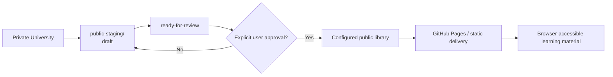

# University Engine Bootstrap Source Package

This file is the complete portable distribution of the **generic University engine architecture**. A capable AI agent with access to an empty private repository must be able to create a functionally and structurally equivalent University from this file alone.

`SETUP.md` intentionally may be large. It is cold context during normal mission work and is optimized for lossless bootstrap reproducibility, not runtime brevity.

## 1. Distribution contract

The bootstrap target is an exact copy of the generic architecture, **without copying profiles, learners, missions, topics, accumulated knowledge/content, framework observations, decision history or version history from the source University**.

The package separates three classes of repository state.

### Packaged static engine files

Generic behavior, hard rules, runtime routing, models, contracts, templates, generic documentation and generic structural indexes. These paths are listed in the manifest below and their canonical contents are embedded verbatim in this file.

A bootstrap agent copies each packaged static file block into the exact target path. Do not paraphrase, regenerate or improve the packaged files during bootstrap.

### Dynamic instance files

Concrete state that belongs to the new University instance, including:

- `UNIVERSITY_PROFILE.md`,
- root `MISSION.md`,
- `learners/index.md`,
- `learners/<learner-id>/LEARNER.md`, catalogs and topics,
- actual `shared/` content beyond the generic index,
- actual `public-staging/` candidates,
- local `decisions/` records/history,
- local `versions/` records/history.

Dynamic files are created from the canonical templates/contracts embedded in this package and the new instance's actual information. Never copy the source University's concrete dynamic values.

### Local cold state outside the exact package

Concrete framework observations under `notes/framework/` are local cold state, not packaged static architecture. A fresh bootstrap does not need to create this directory. When real use exposes a concrete framework limitation/opportunity, create one stable-ID file under `notes/framework/open/`; resolved observations may move to `done/`. These local observations may differ from the current `SETUP.md` until implemented. An implemented observation must be reflected consistently in the resulting engine release and `SETUP.md`.

### `SETUP.md` itself

`SETUP.md` is not recursively embedded as a static file block. It consists logically of:

1. a small local YAML header,
2. this package body beginning at `# University Engine Bootstrap Source Package`.

When bootstrapping another University, copy this package body verbatim and generate a new local header:

```yaml
---
type: University Bootstrap Package
spec_version: 1.0.0
package_format: 1
bootstrap_origin:
  source_repository: <the source SETUP distribution.repository>
  source_engine_version: <the source SETUP distribution.engine_version>
  initialized_at: YYYY-MM-DD
distribution:
  repository: <new target repository full name>
  engine_version: 1.0.0
---
```

A newly generated University therefore starts its **own local engine/spec at `1.0.0`** while preserving the source repository/source engine version as bootstrap provenance.

## 2. Portability and safety before bootstrap

The generic University is a Markdown/text specification interpreted by a capable agent. Understanding, runtime operation and bootstrap must not require Bash/shell scripts, Python scripts, cron jobs, GitHub Actions, external daemons or other execution infrastructure. Host tools/connectors may be used when available, and temporary development tooling may assist one-off implementation checks, but such tooling is never a canonical runtime/bootstrap dependency.

The target core repository must be private from the beginning.

Before **every** repository mutation during bootstrap, freshly query repository metadata and verify:

```text
visibility: private
```

If visibility is public/internal/unknown/unverifiable, hard-stop normal writes. Only an available authorized safety repair restoring `private` is permitted; re-check before continuing.

Never store secrets, credentials, API keys or tokens.

## 3. Lightweight first-learner onboarding

Do not run a long architecture questionnaire. The generic engine architecture in this package is already decided.

For the first learner:

1. Ask for the required human-meaningful visible name naturally in the current conversation language. A legal name is not required.
2. Ensure the visible name is unique inside the University.
3. Generate a stable technical `learner_id` from that name according to `docs/contracts/learner.md`.
4. Ask what the learner wants to use the University for initially, localized naturally to the current conversation language.
5. Offer optional short personalization: the learner may start immediately or answer at most **three adaptive questions** that materially improve current/general interaction.
6. Stop earlier when further questions have little value; do not repeat information already known.
7. Do not invent personal defaults. Unknown learner preferences remain unknown.
8. Route durable learner-wide preferences to `LEARNER.md`; mission/topic-specific information belongs to that topic.
9. There is no onboarding-completion flag.
10. Do not add a separate bootstrap question for a permanent University-wide purpose.
11. Do not ask for `preferred_knowledge_language` during onboarding. A fresh University starts with this optional shared-knowledge default set to `null` unless an actual instance-wide knowledge-language preference is already explicitly established.

If optional personalization is skipped, do not repeatedly remind. Offer it later only when a concrete personalization need appears.

The first created learner becomes `default_learner_id`.

When a later learner is explicitly created, keep the existing default unless the user explicitly changes it. Merely mentioning another person never creates a learner.

Visible learner names must be unique. On a visible-name conflict, ask for another name; do not silently create `Name 2`. A purely technical slug collision may receive a stable technical suffix while leaving the chosen visible name unchanged.

Learner-facing language is learner-/conversation-scoped. Use the current conversation language unless a current instruction or actually known durable learner preference indicates otherwise. Never infer a learner's language from `preferred_knowledge_language` or from another/default learner.

## 4. University charter, chat and topic behavior

A fresh root `MISSION.md` starts with the canonical broad charter in `templates/university-mission.md`. **Do not generate, narrow or reinterpret the University-wide charter from the first learner's first mission.** The first learner mission belongs primarily to that learner's first topic. A concrete instance-wide focus may be added later only when the user explicitly establishes one as durable University-level intent.

Root `MISSION.md` is cold context during normal work. Load it for bootstrap and genuinely University-wide purpose/scope/orientation decisions, not for routine learner/topic turns.

The copied static engine enforces:

- learner-facing chat = exactly one learner for the entire conversation,
- explicitly selected learner at chat start, otherwise default learner,
- greet the bound learner once by visible name at the beginning of a new learner-facing chat,
- never switch learners mid-chat,
- framework/administration chats may be learner-neutral meta chats,
- subject/mission learner-facing chat = exactly one stable `primary_topic`, bound once intent is clear enough,
- clear new mission with no matching topic -> create a new topic automatically and briefly announce its name,
- related same-learner secondary topics may be selectively read/updated without changing the primary topic; announce actual durable secondary writes briefly,
- unrelated work belongs in a new chat,
- no persistent platform chat registry.

## 5. Build sequence

After the minimum onboarding information is available:

1. Re-check target repository visibility before the first write.
2. Create every packaged static path/file from the manifest/file blocks below.
3. Create the target `SETUP.md` using the regenerated local header plus this package body verbatim.
4. Render `UNIVERSITY_PROFILE.md` from `templates/university-profile.md` using actual target repository/provenance/default-learner values. Set local `engine_version: 1.0.0`; keep `preferred_knowledge_language: null` unless an explicit instance-wide neutral-knowledge preference is genuinely known. Do not copy source-instance profile preferences.
5. Create root `MISSION.md` from `templates/university-mission.md` as the canonical University charter. Do not use the first learner mission to rewrite it. Add an instance-wide focus only when one was explicitly established as University-level intent.
6. Render `learners/index.md`, `learners/<id>/LEARNER.md`, and `learners/<id>/catalog/index.md` from their canonical templates.
7. If the first learner mission is concrete enough, create the first topic from `templates/topic/*` and infer `mission_mode`; ask only if ambiguity materially affects ownership/method. If the learner explicitly defers the mission, do not invent a topic.
8. Create `decisions/index.md` as a local empty decision registry; do **not** copy source decision records.
9. Create `versions/index.md` as a local version registry; do **not** copy source version records.
10. Do not create `notes/framework/` merely because the source University has local framework observations. Create it lazily when a concrete local observation exists; use one stable-ID idea file under `open/` and move resolved ideas to `done/`.
11. Make the canonical initial architecture/instance commit for local engine `1.0.0`.
12. In a small follow-up provenance commit, render `versions/1.0.0.md` from `templates/version-record.md`, pointing `source_commit` at the canonical initial architecture commit, and add the `1.0.0` entry to `versions/index.md`.
13. Run the validation in section 7 before declaring bootstrap complete.

A bootstrap request to build from this package authorizes instantiation of this fixed architecture; it is not permission to redesign the framework. Future local core changes use the normal Framework Lock.

## 6. Initial dynamic registry forms

A fresh local decision index may begin as:

```markdown
# Decision Records

Use for important foundational decisions made by this University after bootstrap. Routine learner/mission-state changes do not need a record.

_No local architecture decisions recorded yet._
```

A fresh local version index may begin before finalization as:

```markdown
# Engine Versions

Local engine version history for this University. Source-University history is not copied.

_`1.0.0` provenance will be finalized after the canonical initial architecture commit exists._
```

After the provenance follow-up, replace that placeholder with the local `1.0.0` record link and canonical commit.

## 7. Bootstrap/release validation

A bootstrap or local engine release is incomplete until all checks pass.

### Packaged-static integrity

- Every manifest file exists at the exact listed path.
- Compare every actual packaged static file directly with the corresponding canonical file block below.
- Comparison is textual after normalizing line endings to LF and treating exactly one final LF as canonical.
- The manifest contains **50 packaged static files** and does not include local `notes/framework/` observations.
- No packaged static file may contain concrete learner names/IDs, target-repository identity, accumulated topic/content/history/framework observations, or a hard-coded preferred learner language/mode that should be dynamic.
- Generic engine docs/contracts/templates are English. Intentional references to language-specific resources such as German/English prose tooling are allowed; hard-coded learner onboarding phrases are not.
- `SETUP.md` package body in the target matches this package body verbatim; only the local YAML header differs.

### Dynamic-instance integrity

- `UNIVERSITY_PROFILE.md` has local `engine_version: 1.0.0`, schema compatible with `templates/university-profile.md`, target repository role/visibility, correct `default_learner_id`, bootstrap source provenance, and `preferred_knowledge_language: null` unless a genuine explicit instance-wide neutral-knowledge preference exists.
- Every learner has unique `display_name`, stable `learner_id`, matching path/frontmatter, own catalog/topics and no cross-learner state merge.
- Learner profile contains only actually known durable learner-wide information.
- Learner-facing language is resolved per learner/current conversation rather than from the University knowledge-language default.
- Root `MISSION.md` preserves the canonical broad charter; the first learner mission has not narrowed it.
- Root Mission, topics, catalogs, decisions and versions contain only target-instance state.
- Local framework observations, when any, remain outside the packaged static architecture.
- No source learner/topic/content/decision/version history has leaked into the new University.

### Hard-rule integrity

Confirm that the generated architecture includes and agrees on:

- fresh private-core visibility preflight before every mutation,
- always-on Framework Lock and scope-bound implementation authorization,
- deterministic one-file bootstrap integrity requirement,
- portable Markdown/text interpretation with no mandatory Bash/shell/Python/cron/GitHub-Actions execution dependency,
- canonical cold root University charter separate from learner/topic missions,
- `learn | investigate | achieve | hybrid` mission modes,
- strong Teach-compatible adaptive learning for genuine learning work,
- optional authentic external practitioner/community/project feedback only when materially useful for transfer/validation,
- unique visible learner identity + stable technical ID,
- optional max-three adaptive onboarding with no invented learner defaults,
- no separate permanent-University-purpose bootstrap question,
- learner-/conversation-scoped learner-facing language,
- nullable shared-only `preferred_knowledge_language`,
- one learner per learner-facing chat and one stable primary topic per subject/mission chat,
- source/trust and high-stakes safeguards,
- explicit publication approval and learner isolation,
- root Mission and `notes/` kept out of routine runtime context,
- unpersisted durable-delta synchronization before repository-current/handoff/resume claims,
- deterministic reachability/no-orphan invariant for every new or moved durable non-hot leaf,
- a small two-file hot kernel: `ENTRYPOINT.md` routes tasks and `AGENTS.md` retains unconditional invariants/activation gates, while task-local detail is loaded deterministically from one canonical owner,
- no routing cycle in which an agent must already know a hidden task-local rule to discover the module containing that rule,
- one canonical detailed persistent-mutation procedure loaded task-locally rather than duplicated across the hot kernel,
- semantic `KEEP / MOVE / DROP` Progress compaction with a qualitative hot-context guardrail,
- lazy generalized router/index routing for independently addressable collections without recursive default loading or duplicate volatile truth,
- non-trivial persistent writes routed through exact contracts/canonical ownership/dependent-state/duplication/safety/durable-delta checks,
- decision-relevant real-world results treated as semantic state-transition boundaries with truthful lifecycle/Progress resume state,
- adversarial evidence for material investigation conclusions without false balance,
- epistemic independence in ordinary dialogue: rapport is not evidentiary agreement and learner premises are assessed before endorsement,
- scalable scientific/empirical inquiry inside `investigate` with optional lazy research artifacts and ethics/privacy/source-trust safeguards.

Validation is semantic/textual and must itself be executable by a capable agent from these Markdown/text instructions. A temporary implementation-time tool may assist comparison, but no validator script, workflow, daemon or external service is required or canonical.

## 8. Packaged static manifest

```text
AGENTS.md
CHATGPT_PROJECT_PROMPT.md
CREDITS.md
ENTRYPOINT.md
README.md
docs/CONTENT_FORMATS.md
docs/DESIGN_SYSTEM.md
docs/KNOWLEDGE_MODEL.md
docs/LEARNING_MODEL.md
docs/MISSION_MODEL.md
docs/OUTPUT_FORMATS.md
docs/PROJECT_FOUNDATIONS.md
docs/PROSE_STYLE.md
docs/PUBLICATION.md
docs/REPOSITORY_SAFETY.md
docs/RUNTIME_CONTEXT.md
docs/TOPIC_MODEL.md
docs/VERSIONING.md
docs/contracts/competencies.md
docs/contracts/html-learning-artifacts.md
docs/contracts/knowledge-concept.md
docs/contracts/learner.md
docs/contracts/learning-record.md
docs/contracts/public-material.md
docs/contracts/research.md
docs/contracts/resources.md
docs/contracts/result-packet.md
docs/contracts/topic.md
public-staging/index.md
shared/index.md
templates/competencies.md
templates/decision-record.md
templates/knowledge-concept.md
templates/learner-catalog.md
templates/learner-profile.md
templates/learner-registry.md
templates/learning-record.md
templates/lesson.html
templates/public-material.md
templates/reference.html
templates/research.md
templates/result-packet.js
templates/topic/index.md
templates/topic/MISSION.md
templates/topic/NOTES.md
templates/topic/PROGRESS.md
templates/topic/RESOURCES.md
templates/university-mission.md
templates/university-profile.md
templates/version-record.md
```

## 9. Canonical packaged static file contents

**Extraction rule:** For each `### File:` section below, copy every character between its opening and closing `~~~~~~` fence into the named path. The fence markers themselves are not part of the file. Normalize line endings to LF and write one final LF.

### File: `AGENTS.md`
~~~~~~
# University — Hard Agent Rules

`ENTRYPOINT.md` is the runtime router. This file contains only unconditional invariants and activation gates that must be available before task-local detail is loaded.

## Private-core safety

- Required private-core visibility is exactly `private`.
- At session start verify repository role/visibility.
- Before every mutating GitHub operation against private-core, freshly query metadata and verify `visibility: private`.
- If public/internal/unknown/unverifiable: hard-stop normal writes and notify the learner.
- While broken, only an available/authorized repair restoring `private` is allowed; re-check before normal writes.

## Framework lock

- The generic University framework/core is locked by default and has no persistent `unlocked` state.
- Core means generic engine behavior, runtime routing, bootstrap/setup, models, schemas/contracts, templates, versioning or reusable framework configuration; ordinary learner/mission/knowledge state and cold framework observations are not core merely because they share the repository.
- Discussion, agreement with an idea or a suggestion is not implementation authorization.
- Before any core mutation, summarize the exact proposed scope, why it is needed, affected core areas/files and expected SemVer; obtain explicit current-conversation authorization.
- Authorization is single-use, current-conversation and scope-bound and expires when the agreed change set is completed. New scope or a later conversation requires new authorization.
- A critical safety/privacy/data-integrity defect may stop unsafe work but never bypass the Framework Lock.
- Every implemented core change creates a new engine version and uses branch + PR. Load `docs/VERSIONING.md` for the detailed release procedure.
- Concrete framework observations may be recorded under `notes/framework/open/NNNN-<slug>.md` without unlocking core. They are cold local state, not a runtime task list or part of the exact bootstrap package; explicit framework review reads `open/` only unless historical resolution requires `done/`.
- Normal durable learner/mission/knowledge persistence continues while the framework is locked.

## Learner, chat and topic isolation

- Personal state lives only under `learners/<learner-id>/`; `shared/` is neutral reusable material only.
- Every learner has a unique human-meaningful `display_name` and one stable technical `learner_id`. A visible rename never silently changes the ID or paths.
- Create a learner only on explicit intent. Merely mentioning or working for another person is not learner creation. Load `docs/contracts/learner.md` for creation, onboarding, profile and registry detail.
- A learner-facing chat binds exactly one learner for its lifetime: explicit learner at chat start, otherwise `default_learner_id`. Never silently switch learners or merge/reuse learner-specific state across IDs.
- A subject/mission learner-facing chat has one `primary_topic`, bound once intent is clear enough and fixed for that chat. Related same-learner secondary-topic access is selective and does not change the primary topic; unrelated work belongs in another chat.
- Never persist a platform chat-ID registry merely for learner/topic routing.
- Resolve genuinely ambiguous personal-state ownership before persistence.

## Epistemic independence

- Rapport is not evidentiary agreement. Evaluate learner premises, framings and proposed explanations independently before affirming them.
- Agree only to the extent supported by current evidence/reasoning; when material evidence or logic cuts against a premise, say so clearly. Separate supported, unsupported and uncertain parts rather than mirroring confidence or desired conclusions.
- Do not manufacture ceremonial disagreement for trivial matters. Load `docs/KNOWLEDGE_MODEL.md` when factual trust, important investigation conclusions, adversarial evidence or high-stakes/current-source rigor is relevant.

## Mandatory activation gates

Task-local procedure may live outside the hot kernel only because these activation conditions remain always visible:

- **Learner creation/profile/registry** -> load `docs/contracts/learner.md` plus minimum relevant registry/profile state.
- **Mission definition/change, mission-mode planning or empirical/scientific inquiry** -> load `docs/MISSION_MODEL.md`; empirical persistence also loads `docs/contracts/research.md` when research state is created/updated.
- **Learning, competency, practice, validation or Tutor-stance decisions** -> load `docs/LEARNING_MODEL.md` plus exact relevant learning/topic contract/state.
- **Investigation, factual/current claims, source/trust/freshness or medical/legal/financial/safety-critical work** -> load `docs/KNOWLEDGE_MODEL.md` plus relevant current authoritative sources.
- **Any non-trivial persistent write** -> load `docs/CONTENT_FORMATS.md` plus every exact governing contract before mutation and follow its canonical mutation/completion procedure.
- **Substantial/publishable prose or explicit humanization/style work** -> load `docs/PROSE_STYLE.md`; style never overrides factual/safety/evidence semantics.
- **Public staging/publication** -> load `docs/PUBLICATION.md` plus exact public contract/artifact; configured public-library mutation always requires explicit approval for the exact material/change.
- **Structural/schema/foundational/version work** -> load `docs/VERSIONING.md` after Framework-Lock authorization.
- **Bootstrap/reconstruction** -> use `SETUP.md` as the portable source package; do not substitute source-instance learner/topic/history state.

Never move an activation trigger behind the module whose loading it is supposed to trigger.

## Persistent-state integrity

- Durable state has one canonical owner; avoid duplicate canonical narratives and mirrored volatile leaf state.
- Every new or moved durable non-hot leaf must be deterministically reachable from the normal runtime/resume graph of its owning scope before persistence is complete. Blind recursive listing or repository search is recovery, not routing.
- A known decision-relevant durable change that is not yet persisted is an unpersisted durable delta. Do not claim the repository is current, use it as a truthful resume/handoff point, or intentionally end a meaningful work segment while such a delta remains.
- Decision-relevant real-world results are semantic state-transition boundaries: affected Progress/lifecycle/routing/stale-next-step state must be reconsidered together under the exact contract/procedure.
- Detailed canonical ownership, dependent-state, reachability, duplication, safety/authorization, semantic-transaction and post-write checks live in `docs/CONTENT_FORMATS.md`; `PROGRESS.md` compaction semantics live in the topic contract.

## Public, secrets and destructive actions

- Never mutate the configured public-learning-library without explicit approval for that exact material/change; prepare candidates privately first and never expose learner-private state there.
- Never store passwords, API keys, tokens, credentials or secrets.
- Before deleting a learner/topic, summarize impact and obtain explicit confirmation. Git history may remain.

## Conversation and language baseline

- Structured internal state must not make ordinary conversation sound like a workflow log. Keep dialogue natural and subject/mission-centered; do not routinely narrate persistence, routing, evidence bookkeeping or internal next-step selection.
- Briefly expose user-relevant scope events such as creation of a new primary topic, an actual durable write to a related secondary topic, or a persistence failure that makes the repository unsafe to treat as current.
- System/agent content, schemas, metadata, paths, templates and architecture docs are English. Learner-facing wording follows the active learner/current conversation language and any actually known durable learner preference.
- `preferred_knowledge_language`, when set, applies only to neutral shared/maintained knowledge; it never silently determines learner-facing language.

## Context and portability

- Use the minimum sufficient context, not the minimum sufficient answer. Do not preload cold docs, unrelated learners/topics/contracts/sources or unused mission/learning/style/design modules.
- `ENTRYPOINT.md` owns runtime task routing; `docs/RUNTIME_CONTEXT.md` owns detailed context-economy policy and is loaded when runtime-loading architecture itself is relevant, not as an additional default manual.
- Context economy never weakens private preflight, Framework Lock, learner/topic isolation, public approval, source/trust, safety/ethics, evidence integrity, destructive confirmation or current explicit learner instructions.
- The University runtime/bootstrap must remain interpretable from repository Markdown/text without mandatory shell/Python/cron/GitHub-Actions/daemon infrastructure. Temporary implementation tooling is allowed but is never a runtime/bootstrap dependency.
- `SETUP.md` remains an exact portable source package for the generic static engine; local instance/version provenance stays in designated dynamic/header/version records rather than static engine files.

## Git workflow

- Small low-risk learner-state/resource changes may go direct when permitted.
- Structural/schema/foundational/version changes require Framework-Lock authorization and branch + PR.
- Public writes require exact approval.
- Private-core preflight applies before every mutation.
~~~~~~

### File: `CHATGPT_PROJECT_PROMPT.md`
~~~~~~
# ChatGPT Project Prompt

Use this minimal host-level instruction when the AI host already has repository access:

```text
Read ENTRYPOINT.md from the connected University repository before substantial work and follow it as the canonical runtime router. Use GitHub as durable state, but load repository context selectively according to ENTRYPOINT/RUNTIME_CONTEXT instead of preloading the whole University. Keep meaningful durable state updated under the repository rules.
```

Do not duplicate the University operating model in the host prompt. The repository remains the canonical versioned source of truth.

If the host cannot access the repository, connect/provide the repository and direct it to `ENTRYPOINT.md`.
~~~~~~

### File: `CREDITS.md`
~~~~~~
# Credits and research foundations

This University is a project-specific mission system built from upstream skills, knowledge-format specifications, learning/behavior/decision-science research, scientific/open-research practice, platform capabilities, language-editing references, and local synthesis. When the architecture adopts a named external idea, this file preserves a traceable source and describes its role.

## Upstream agent skills

### Teach Skill — Matt Pocock

Source: https://github.com/mattpocock/skills/tree/main/skills/productivity/teach

Role:

- mission-grounded learning,
- trusted resources/source-first factual teaching,
- learning records,
- short lessons / zone-of-proximal-development thinking,
- retrieval, spacing and interleaving,
- practical feedback loops,
- reusable lesson/reference assets,
- real-world/practitioner/community interaction as a possible source of wisdom/feedback,
- explicit rejection of parametric model memory as a trusted factual source.

Local adaptation: authentic external feedback is optional and mission-dependent. For suitable `master` or transfer-intensive learning, practitioner/community/code-review/trainer/domain-forum/authentic-project feedback may strengthen transfer or validation when materially useful; the University does not require community participation and does not treat outside feedback as automatic factual truth or mastery evidence.

### Grilling Skill — Matt Pocock

Source: https://github.com/mattpocock/skills/tree/main/skills/productivity/grilling

Role: structured discovery of unresolved decisions and user-owned choices. Local override: exactly one grilling question per message/round.

### Matt Pocock skills license

MIT: https://github.com/mattpocock/skills/blob/main/LICENSE

Copyright (c) 2026 Matt Pocock. Preserve applicable attribution/license notices if upstream material is substantially adapted.

## Language-aware prose quality

### Humanizer (Deutsch) — Martin Moeller / marmbiz

Repository: https://github.com/marmbiz/humanizer-de

Author guide: https://martin-moeller.biz/lab/ki/humanizer-deutsch-ki-texte-erkennen-entfernen

Reviewed upstream state: 2026-08-16, repository release line v5.17.2.

Role in this University:

- German-specific naturalness/register/rhythm editing,
- claim/fact protection during rewrite,
- targeted editing instead of mandatory rewriting,
- null-edit behavior when prose is already good,
- treating pattern/rhythm checks as quality heuristics rather than proof of authorship.

The University does **not** vendor or reproduce the Humanizer-DE pattern catalog. Its repository documents mixed licensing: project code/original project material under MIT, while its adapted pattern catalog and corresponding catalog descriptions/tables are under CC BY-SA 4.0; see the upstream LICENSE/NOTICE for exact scope. The University adopts high-level workflow/guardrail ideas and keeps its own compact fallback.

### Humanizer — blader

Repository: https://github.com/blader/humanizer

Reviewed upstream state: 2026-08-16, v2.9.1.

License: MIT.

Role in this University:

- preserve information rather than mimic source shape,
- no-fabrication guard during prose rewrite,
- voice calibration from an authorized/user-provided writing sample,
- removal of formulaic/promotional/vague AI-style prose when it harms quality,
- second-pass audit when a substantial rewrite benefits from it.

Humanizer-DE originated historically from this English project and later developed its own German-specific system.

### Wikipedia / WikiProject AI Cleanup

Reference: https://en.wikipedia.org/wiki/Wikipedia:Signs_of_AI_writing

Role: observational upstream basis referenced by the Humanizer projects for recurring AI-writing patterns. The University's prose policy is quality-oriented and does not use these observations as an authorship detector or detector-bypass objective.

## Knowledge architecture

### LLM Wiki — Andrej Karpathy

Reference: https://gist.github.com/karpathy/442a6bf555914893e9891c11519de94f

Role:

- cumulative maintained memory rather than chat dump,
- navigable entrypoints/hierarchy,
- progressive disclosure,
- update curated knowledge instead of duplicate summaries,
- separate provenance/source material from interpretation,
- human- and agent-readable documentation.

### Open Knowledge Format (OKF)

Specification: https://github.com/GoogleCloudPlatform/knowledge-catalog/blob/main/okf/SPEC.md

Role:

- Markdown + YAML for durable concepts,
- source provenance,
- distinct generated/verified metadata,
- actor/version provenance,
- derived trust tiers (`unverified`, `machine-confirmed`, `human-reviewed`),
- freshness/lifecycle awareness,
- Git-friendly portability.

The University's verify-before-stable gate is a local synthesis of source-first teaching and provenance/trust ideas rather than claimed strict OKF conformance.

## Scientific / empirical inquiry foundations

These references inform the scalable scientific-inquiry lens. The University does not claim strict conformance with any single discipline-specific research standard; method details remain task/domain dependent and rigor scales with consequence and inference needs.

### NIH — rigor and reproducibility

Reference: https://www.grants.nih.gov/policy-and-compliance/policy-topics/reproducibility

Influence: rigorous research requires robust/unbiased experimental design, methodology, analysis, interpretation and transparent reporting so findings can be assessed, reproduced and extended. Local adaptation: the University applies these ideas beyond biomedical work as a general research-quality lens without importing NIH grant bureaucracy.

### National Academies — reproducibility and replicability

National Academies of Sciences, Engineering, and Medicine, *Reproducibility and Replicability in Science* (2019). https://nap.nationalacademies.org/catalog/25303/reproducibility-and-replicability-in-science

Influence: distinguish computational/analytic reproducibility from replication with new/independent evidence and treat transparent methods/data/code where feasible as part of trustworthy scientific practice. Local adaptation: the University separately records computational reproducibility, internal robustness and external replication/validation instead of collapsing them into one “verified” label.

### Preregistration / confirmatory vs exploratory separation

Brian A. Nosek, Charles R. Ebersole, Alexander C. DeHaven & David T. Mellor, *The preregistration revolution* (2018). https://doi.org/10.1073/pnas.1708274114

Influence: distinguish hypotheses/analysis plans specified before outcome knowledge from exploratory/post-hoc discoveries and preserve transparency about when choices were made. Local adaptation: `RESEARCH.md` may preserve an auditable pre-data plan/amendments, but the University never calls that plan `preregistered` unless a real external preregistration exists.

### FAIR data principles

Mark D. Wilkinson et al., *The FAIR Guiding Principles for scientific data management and stewardship* (2016). https://doi.org/10.1038/sdata.2016.18

Influence: useful research data/metadata should preserve identifiers, provenance and reuse-oriented context where appropriate. Local adaptation: the University adopts practical data-lineage/provenance ideas; it does not require every private learner study to publish data or implement a full FAIR repository.

### Human-subject research ethics — Belmont Report

U.S. Department of Health & Human Services / Office for Human Research Protections, *The Belmont Report*. https://www.hhs.gov/ohrp/regulations-and-policy/belmont-report/index.html

Influence: respect for persons, beneficence and justice as foundational considerations for human-subject research. Local adaptation: the University performs a risk-scaled ethics/privacy gate and routes required formal approval externally; it never represents itself as an IRB/ethics committee or regulator.

## Mission execution, behavior and decision research

These sources inform lightweight optional mission lenses. The University does not mechanically implement the full intervention/research frameworks.

### Implementation intentions

Peter M. Gollwitzer & Paschal Sheeran, *Implementation Intentions and Goal Achievement: A Meta-Analysis of Effects and Processes* (2006). https://doi.org/10.1016/S0065-2601(06)38002-1

Influence: when a meaningful feasible goal already exists but execution repeatedly breaks down, a concrete cue-response `if situation Y, then action X` plan can help bridge intention and action. The University uses this selectively rather than requiring if-then plans for every task.

### Mental contrasting with implementation intentions (MCII)

Guoxia Wang, Yi Wang & Xiaosong Gai, *A Meta-Analysis of the Effects of Mental Contrasting With Implementation Intentions on Goal Attainment* (2021). https://doi.org/10.3389/fpsyg.2021.565202

Influence: combine attention to the desired outcome with the important real obstacle before choosing a response plan where useful. The meta-analysis reported a small-to-medium aggregate effect and noted possible publication bias, so the University treats MCII as a situational aid rather than a guaranteed or universal intervention.

### COM-B / Behaviour Change Wheel

Susan Michie, Maartje M. van Stralen & Robert West, *The Behaviour Change Wheel: A New Method for Characterising and Designing Behaviour Change Interventions* (2011). https://doi.org/10.1186/1748-5908-6-42

Influence: when behavior change is a material blocker, distinguish capability, opportunity and motivation before choosing an intervention. Local adaptation: COM-B is a compact diagnostic lens; the University does not require the full Behaviour Change Wheel for every behavior-related mission.

### Value of Information

Christopher H. Jackson, Gianluca Baio, Anna Heath, Mark Strong, Nicky J. Welton & Edward C. F. Wilson, *Value of Information Analysis in Models to Inform Health Policy* (2022). https://doi.org/10.1146/annurev-statistics-040120-010730

Influence: additional information has value when reducing uncertainty can improve a decision; the source explicitly notes that the underlying ideas generalize beyond healthcare to evidence-synthesis and decision problems. Local adaptation: the University uses a qualitative stopping heuristic—whether material uncertainty could change the decision and is worth the cost/delay/risk of resolving—rather than claiming formal numerical VOI analysis.

## Learning science and tutoring research

The University uses these works as design roots rather than mechanically implementing each paper.

### Mastery learning

Benjamin S. Bloom, *Learning for Mastery* (1968). https://eric.ed.gov/?id=ED053419

Influence: observable mastery targets, adaptive instruction to demonstrated state, explicit targets for important competencies.

### Knowledge tracing / learner-state modeling

Albert T. Corbett & John R. Anderson, *Knowledge tracing: Modeling the acquisition of procedural knowledge* (1995). https://doi.org/10.1007/BF01099821

Influence: skill-component state changes informed by evidence. Local adaptation: qualitative evidence-backed states instead of Bayesian mastery probabilities.

### ICAP / learner generation

Michelene T. H. Chi & Ruth Wylie, *The ICAP Framework* (2014). https://doi.org/10.1080/00461520.2014.965823

Influence: prefer constructive/interactive learner generation when appropriate; activity alone is not deep engagement.

### Productive Failure

Manu Kapur, *Productive Failure in Learning Math* (2014). https://doi.org/10.1111/cogs.12107

Influence: selective learner attempt before instruction when prerequisites/task make the attempt productive; never force aimless frustration.

### Expertise reversal / adaptive scaffolding

Slava Kalyuga, Paul Ayres, Paul Chandler & John Sweller, *The Expertise Reversal Effect* (2003). https://doi.org/10.1207/S15326985EP3801_4

Influence: guidance depends on expertise; fade redundant support as competence rises.

### Worked examples and fading

Alexander Renkl, Robert K. Atkinson, Uwe H. Maier & Richard Staley, *From Example Study to Problem Solving: Smooth Transitions Help Learning* (2002). https://doi.org/10.1080/00220970209599510

Related worked-example/self-explanation research: https://doi.org/10.1016/S0959-4752(01)00030-5

Influence: worked examples for novice/high-complexity situations, meaningful self-explanation, transition to completion/independent work.

### Self-regulated learning

Barry J. Zimmerman, *Becoming a Self-Regulated Learner: An Overview* (2002). https://doi.org/10.1207/S15430421TIP4102_2

Influence: selective planning/monitoring/reflection and metacognitive calibration without compulsory journaling or permanent confidence scores.

### Retrieval / spacing / interleaving

Doug Rohrer & Kelli M. Taylor, *The Shuffling of Mathematics Practice Problems Boosts Learning* (2007). https://doi.org/10.1007/s11251-007-9015-8

Doug Rohrer, Robert F. Dedrick & Sandra Stershic, *Interleaved Practice Improves Mathematics Learning* (2015). https://doi.org/10.1037/edu0000001

Influence: retrieval after learning, interleave related skills after acquisition, prefer opportunistic/transfer-rich practice over mandatory generic calendar SRS.

### Whole-task learning

Jeroen J. G. van Merriënboer, Richard E. Clark & Marcel B. M. de Croock, *Blueprints for Complex Learning: The 4C/ID-Model* (2002). https://doi.org/10.1007/BF02504993

Influence: integrate part-skills into authentic whole tasks, diagnose gaps, repair targeted parts, gradually increase complexity.

### Structured learner agency

Hyungshim Jang, Johnmarshall Reeve & Edward L. Deci, *Engaging Students in Learning Activities: It Is Not Autonomy Support or Structure but Autonomy Support and Structure* (2010). https://doi.org/10.1037/a0019682

Influence: combine tutor structure with genuine learner choice when multiple pedagogically sound paths exist.

### Cognitive load / multimedia learning

Richard E. Mayer & Roxana Moreno, *Nine Ways to Reduce Cognitive Load in Multimedia Learning* (2003). https://doi.org/10.1207/S15326985EP3801_6

Influence: coherence, contiguity, signaling, segmenting and avoiding redundant representations without learning value. These also inform the University Design System.

### Intelligent tutoring systems

Kurt VanLehn, *The Relative Effectiveness of Human Tutoring, Intelligent Tutoring Systems, and Other Tutoring Systems* (2011). https://doi.org/10.1080/00461520.2011.611369

Influence: tutoring as adaptive interaction loop, step/skill-level evidence, distinction between learning support and independent evidence.

### AI-specific tutoring behavior

LearnLM Team et al., *LearnLM: Improving Gemini for Learning* (2024). https://arxiv.org/abs/2412.16429

Rose E. Wang et al., *Tutor CoPilot: A Human-AI Approach for Scaling Real-Time Expertise* (2024). https://arxiv.org/abs/2410.03017

Influence: pedagogical behavior/model capability matter; guiding questions, adaptation, engagement, cognitive-load management and metacognition can be explicit tutor behaviors; architecture should constrain agents rather than assume equal capability.

## Platform implementation references

### GitHub Pages

https://docs.github.com/en/pages/getting-started-with-github-pages/what-is-github-pages

Used for static HTML/CSS/JavaScript learning material and the optional backend-free public layer.

### Web Clipboard API

https://developer.mozilla.org/en-US/docs/Web/API/Clipboard/writeText

Used for the learner-triggered `Copy result` interaction in `UNIVERSITY_RESULT/1`. Browser permissions/support are variable, so the University requires a visible manual-copy fallback.

## Local University synthesis

The following are local mechanisms/policies rather than direct copies of one source:

- protected cold root University charter separated from learner/topic missions,
- Mission Topic model with `learn | investigate | achieve | hybrid`,
- qualitative mission loop `clarify -> inspect -> choose -> act/research/learn -> observe -> adapt`,
- lightweight optional mission lenses: implementation support, COM-B bottleneck diagnosis, qualitative Value-of-Information stopping logic and scalable scientific/empirical inquiry,
- mission-adaptive Progress and completion semantics,
- semantic Progress `KEEP / MOVE / DROP` compaction gate and qualitative hot-context guardrail rather than append-only histories or arbitrary size/time splitting,
- unpersisted-durable-delta synchronization discipline before repository-current/handoff/resume claims,
- framework locked by default with single-use scope-bound implementation authorization and mandatory versioning for core changes,
- cold non-runtime per-idea framework observation lifecycle under `notes/framework/open/` and `done/`, intentionally outside the exact static bootstrap package,
- Markdown/text-first portable engine/bootstrap with no mandatory shell/Python/cron/GitHub-Actions execution dependency,
- learner-/conversation-scoped learner-facing language plus optional nullable University shared-knowledge language,
- natural conversation UX that keeps internal persistence/routing/evidence mechanics out of routine dialogue while preserving substantive feedback,
- multi-learner partition under `learners/<id>/` and default-learner routing,
- hard cross-learner state isolation and neutral `shared/` boundary,
- qualified learner/topic/competency/evidence references,
- lazy topic-local `COMPETENCIES.md`,
- qualitative states `not-demonstrated -> emerging -> demonstrated -> durable`,
- `core/supporting` targets and `required/helpful` prerequisites,
- Learning Records as canonical evidence and Competency Map as interpretation,
- support-aware `independent | light | scaffolded` evidence,
- practice-vs-validation anti-contamination rules,
- evidence freshness without automatic time decay,
- transfer-aware durable evidence,
- optional authentic external practitioner/community/project feedback as a transfer/validation aid,
- adaptive next-learning policy based on mission/readiness/need/retrieval,
- diagnostic error categories as working hypotheses,
- topic-local adaptive Tutor stance,
- source-grounded verify-before-stable and capability gates,
- adversarial/disconfirming evidence rule for material investigation conclusions without false balance,
- scalable scientific inquiry with inferred `lightweight | structured | high-rigor`, optional lazy `RESEARCH.md`/`research/`, pre-data-plan/amendment integrity, measurement/data-lineage/bias/uncertainty/validation/ethics/reporting gates,
- explicit model/agent provenance with model-neutral generic examples,
- `UNIVERSITY_RESULT/1` stateless public-to-private handoff,
- Hot/Cold runtime routing and `minimum sufficient context, not minimum sufficient answer`,
- granular artifact-contract routing,
- `runtime_notes` as a topic-context hint,
- quality-first output economy,
- canonical mission-aware Topic Status / Overview / Next Step / Result / Completion renderers,
- functional-symbol semantics for lifecycle/competency/flow while keeping text/color-independent meaning,
- host-independent mobile/accessibility design rules,
- selective DE/EN prose-quality routing that combines Humanizer-inspired naturalness with University-specific protected factual/evidence anchors.

The Humanizer projects influence the prose-quality layer; the University's exact routing thresholds, protected-anchor integration, status renderer set, symbol vocabulary, mission routing, inquiry routing and learning-state semantics are local synthesis.

## Local University design

The final operating model is project-specific. Local rules may intentionally differ from upstream defaults when documented. In conflicts, the University's hard-rule/runtime precedence applies.
~~~~~~

### File: `ENTRYPOINT.md`
~~~~~~
# University — Agent Runtime Entrypoint

Canonical compact runtime router. GitHub is durable state; chat is the interaction layer. Load only what the current task needs.

## Startup kernel

1. Query current repository metadata.
2. Read `UNIVERSITY_PROFILE.md` once for role/configuration/default learner.
3. If role is `private-core`, verify visibility is exactly `private`.
4. Read `AGENTS.md` for unconditional invariants and activation gates.
5. Classify the current conversation as University-wide meta or learner-facing.
6. For learner-facing work, bind exactly one learner for the chat lifetime; bind one `primary_topic` once subject/mission intent is clear enough.
7. For known-topic work, read topic `index.md` then `PROGRESS.md` and route by the current task/`mission_mode`.
8. Follow only the relevant activation route below; do not preload unrelated models/contracts/sources.

Do not automatically read README, SETUP, root `MISSION.md`, CREDITS, Foundations, Decisions, `notes/`, all learners/topics/contracts or all Mission/Learning/Knowledge/output/design/prose docs.

## Conversation binding

### University-wide meta

Framework design/review, administration, learner creation, architecture/versioning and similar University-wide work may remain learner-neutral and topic-neutral. Do not silently assign the default learner merely because one exists.

Root `MISSION.md` is the cold University charter. Load it only for bootstrap or genuinely University-wide purpose/scope/orientation decisions.

### Learner-facing

Use an explicitly named existing learner at chat start when supplied; otherwise use `default_learner_id`. Never switch learners mid-chat. Address the learner naturally by visible name once at the beginning of a new learner-facing conversation; technical IDs stay internal unless administrative clarity requires them.

Before intent is clear enough, a learner-facing chat may be learner-bound without a primary topic. Match an existing topic when appropriate. If no existing topic fits and the mission is clear, create a new topic without an extra confirmation step and briefly announce its visible name. Clarify only when ambiguity materially changes ownership/method. Once bound, `primary_topic` remains fixed.

A related same-learner secondary topic may be selectively read/updated for a genuine relationship without changing the primary topic. Briefly mention an actual durable secondary-topic write. Unrelated work belongs in another chat.

## Task router

| Current task/condition | Load next |
|---|---|
| New learner creation/profile/registry change | `docs/contracts/learner.md` + minimum registry/profile state |
| Normal known-topic continuation | primary topic `index.md` + `PROGRESS.md`; learner profile only when personalization materially matters |
| Mission definition/change/resume or mode-specific planning | `docs/MISSION_MODEL.md` + topic `MISSION.md` + `PROGRESS.md` |
| Learning/competency/practice/validation/Tutor stance | `docs/LEARNING_MODEL.md` + relevant topic state/exact learning contracts |
| Investigation/research/problem analysis | `docs/MISSION_MODEL.md` + `docs/KNOWLEDGE_MODEL.md` + relevant Resources/sources/data |
| Original data collection / empirical inference / research-like evaluation | investigation route + `docs/contracts/research.md`; use durable research state only when it improves traceability |
| Achievement planning/action review | `docs/MISSION_MODEL.md` + Mission/Progress; add Knowledge/Learning modules only for the concrete blocker |
| Factual/current/high-stakes work | `docs/KNOWLEDGE_MODEL.md` + relevant current authoritative sources |
| Non-trivial persistent artifact write | `docs/CONTENT_FORMATS.md` -> every exact governing contract/template -> canonical mutation/completion procedure |
| Topic/learner status or recurring system view | `docs/OUTPUT_FORMATS.md` + minimum relevant state |
| New/atypical visual layout or HTML design | `docs/DESIGN_SYSTEM.md` + exact artifact contract |
| Substantial/publishable prose or explicit humanization | `docs/PROSE_STYLE.md` |
| Learner/topic discovery | active learner catalog; global learner registry only when learner discovery/multi-learner administration requires it |
| University-wide purpose/scope/orientation | root `MISSION.md` + minimum relevant profile/engine context |
| Shared reusable material | `shared/index.md` + relevant shared artifact/contract |
| Public staging/publication | `docs/PUBLICATION.md` + exact public contract/artifact |
| `UNIVERSITY_RESULT/1` | result-packet contract + exact lesson/revision + already bound learner/evidence state |
| Explicit framework review | relevant engine docs + `notes/framework/open/`; read `done/` only for directly relevant history/resolution |
| Authorized architecture/schema/version change | `docs/VERSIONING.md` + agreed scope + only relevant engine/provenance docs |
| Runtime/context-loading architecture review | `docs/RUNTIME_CONTEXT.md` |
| Bootstrap another University | `SETUP.md` only |

If a turn spans multiple rows, load only the union actually needed. Hybrid missions do not justify loading every model.

## Known-topic runtime path

Path: `learners/<learner-id>/topics/<topic-id>/`.

Default known-topic reads are `index.md`, then `PROGRESS.md`. Selectively load Mission, Notes (`runtime_notes: true`), Competencies, Resources, `RESEARCH.md`, referenced Learning Records or exact lesson/reference/research artifacts only when the current route requires them.

When a logical collection has a router/index, read the compact router and then only the relevant canonical leaf. Never recursively load learner/topic/research trees by default.

The topic mission chooses the operating method: `learn | investigate | achieve | hybrid`. Detailed mission behavior and scientific-inquiry activation live in `docs/MISSION_MODEL.md`; detailed pedagogy/evidence lives in `docs/LEARNING_MODEL.md`; factual/source epistemics lives in `docs/KNOWLEDGE_MODEL.md`.

## Persistence boundary

For any non-trivial durable write, the Content Formats route is mandatory even when the task began under another route. Load `docs/CONTENT_FORMATS.md` plus every exact target contract and follow the procedure through post-write completion. A decision-relevant external result may require multiple coordinated Git writes but is one semantic persistence segment.

Do not treat the repository as current while a known durable delta or orphaned durable leaf remains. Successful routine persistence stays conversationally invisible unless the learner needs a decision/ambiguity/failure/scope notice.

## Conversation behavior

Keep ordinary dialogue centered on the subject, question, decision, action or learning task rather than University mechanics. Preserve substantive feedback when it helps the learner understand what an answer/action/result demonstrates. Avoid ceremonial workflow narration and redundant recaps.

Learner-facing language follows the current conversation and actually known learner preference. University-level `preferred_knowledge_language` is only for neutral shared/maintained knowledge.

## Cold context and output quality

Normally keep README, SETUP, root `MISSION.md`, CREDITS, Foundations, Decisions, VERSIONING/version records, `notes/`, unrelated learners/topics/contracts/templates and unused Mission/Learning/Knowledge/output/design/prose guides out of runtime context.

Use the minimum sufficient context, not the minimum sufficient answer. Correctness/safety, clarity, learning/research/decision effectiveness, appropriate completeness and actionable usefulness outrank token economy.

## Repository workflow

Routine low-risk learner-state/resource changes may go direct when allowed. Structural/schema/foundational/version changes require the Framework Lock in `AGENTS.md` and branch + PR. Public writes require exact approval. Before every private-core mutation, freshly verify `visibility: private`.
~~~~~~

### File: `README.md`
~~~~~~
# University

A private, persistent **multi-learner mission operating system**: AI-assisted learning, investigation, goal achievement, GitHub durable state, source-grounded knowledge, reusable learning material, and scalable scientific/empirical inquiry.

> Humans: start here. AI agents: `ENTRYPOINT.md`. Build another University from one file: `SETUP.md`.

## Core model

A University serves multiple learners without merging their personal state. `UNIVERSITY_PROFILE.md` provides instance configuration and a routing default; each learner owns a separate `learners/<learner-id>/` workspace. Shared material is neutral and learner-independent.

Root `MISSION.md` is a cold University-wide charter. The first learner's first mission belongs to that learner's first topic and never silently narrows the University's global purpose.

## Mission modes

A topic is a persistent mission workspace, not necessarily a course.

| Mode | Primary purpose |
|---|---|
| `learn` | build usable, durable understanding or skill |
| `investigate` | answer a question, analyze evidence/options, reduce uncertainty |
| `achieve` | move a real-world outcome forward through planning/action/adaptation |
| `hybrid` | combine only the mechanisms the mission genuinely needs |

**Mission first, method second.** Competencies/tests are useful for genuine learning, not mandatory for every investigation or real-world goal.

## Scientific / empirical inquiry

Research-like work stays inside `investigate` (or the investigation component of `hybrid`); there is no separate research mission mode.

When work involves original data collection, empirical inference, comparative evaluation or similarly research-like knowledge generation, the engine can activate a scalable scientific-inquiry lens with inferred rigor:

- `lightweight` — ordinary exploratory/low-consequence inquiry,
- `structured` — original data or conclusions that need a traceable method/inference trail,
- `high-rigor` — high consequence, publication/reproducibility need, strong causal claims or substantial independent scrutiny.

The protocol scales across: **Frame → Design → Collect → Analyze → Challenge → Interpret & Validate → Report & Revise**. It includes adversarial evidence, pre-data-plan/amendment integrity, operationalization, data lineage, sampling/stopping, missing-data/data-quality handling, causal/bias discipline, uncertainty/robustness, ethics/privacy, validation/replication and non-selective reporting where relevant.

`RESEARCH.md` is optional and lazy. Ordinary lookup/research does not create it. When method/auditability state matters, `RESEARCH.md` is the topic-local entrypoint and optional actual artifacts may live under `research/` (`data/`, `analysis/`, `code/`) only as needed.

## Runtime economy and durable state

Known-topic work starts with `index.md + PROGRESS.md`, then loads only task-relevant state/models/contracts/sources.

> Use the minimum sufficient context, not the minimum sufficient answer.

`PROGRESS.md` remains a compact current snapshot. On meaningful writes the engine reasons through:

- **KEEP** — needed to resume or make the next decision,
- **MOVE** — durable detail that belongs in a canonical evidence/knowledge/resource/research/sub-mission artifact,
- **DROP** — superseded/intermediate/redundant state recoverable from Git.

No arbitrary age/byte/token split threshold is used. If Progress itself starts consuming a substantial share of normal hot context, compaction review is mandatory.

After decision-relevant durable state changes, the not-yet-written difference is an **unpersisted durable delta**. Before the repository is described as current, used as the resume/handoff point, or a meaningful segment is intentionally paused/ended, that delta must be persisted successfully.

## Framework observations

Framework observations are cold local state under `notes/framework/`, outside the deterministic bootstrap package.

- new observations: `notes/framework/open/NNNN-<slug>.md`, one idea per file,
- resolved observations: `notes/framework/done/NNNN-<slug>.md`, retaining the stable ID and resolution/version metadata,
- explicit framework/version review reads `open/` by default; `done/` is historical context loaded only when needed.

Observations are not tasks, priorities, approvals or framework-unlock state.

## Conversation, language and isolation

Learner-facing chats bind exactly one learner for the conversation. Subject/mission chats bind one stable primary topic once intent is clear. Related same-learner secondary topics may be consulted selectively; unrelated work belongs in another chat.

Generic engine docs/contracts/templates/metadata are English. Learner-facing language follows the active learner/current conversation and actually known learner preferences. University `preferred_knowledge_language`, when set, applies only to neutral shared/maintained knowledge.

Structured internal state does not imply workflow-log conversation. Routine dialogue stays centered on the learner's subject, decision or action.

## Deterministic bootstrap and portability

`SETUP.md` is the standalone portable source package for the generic engine. Its package body contains the exact packaged-static manifest and canonical content of every packaged static file. Local profiles, learners, topics, version history and framework observations are dynamic/local state and are not copied from the source University.

A newly bootstrapped University begins its own local engine/spec line at `1.0.0` while preserving source provenance separately.

The generic engine is Markdown/text-first and must remain interpretable without mandatory Bash/shell scripts, Python scripts, cron jobs, GitHub Actions or daemons. Temporary development tooling may verify a release but is never a runtime/bootstrap dependency.

## Framework lock and safety

The generic core is locked by default. Core implementation requires an explicit scope/reason/affected-area/SemVer summary and a single-use current-conversation authorization. Structural/version changes use branch + PR and create a new local engine version.

Private-core must remain exactly `private`; metadata is freshly checked before every mutation. Public writes require exact approval. Secrets are never stored. High-stakes/current work uses stronger source, uncertainty, ethics and safety handling.

## Key docs

- Runtime/hard rules: `ENTRYPOINT.md`, `AGENTS.md`, `docs/RUNTIME_CONTEXT.md`
- Mission/research routing: `docs/MISSION_MODEL.md`
- Knowledge/evidence/inference: `docs/KNOWLEDGE_MODEL.md`
- Learners/topics: `docs/contracts/learner.md`, `docs/TOPIC_MODEL.md`, `docs/contracts/topic.md`
- Research record/artifacts: `docs/contracts/research.md`, `templates/research.md`
- Learning: `docs/LEARNING_MODEL.md`
- Artifact router: `docs/CONTENT_FORMATS.md`
- Outputs/design/prose: `docs/OUTPUT_FORMATS.md`, `docs/DESIGN_SYSTEM.md`, `docs/PROSE_STYLE.md`
- Publication: `docs/PUBLICATION.md`
- Versioning/bootstrap: `docs/VERSIONING.md`, `SETUP.md`
- Research/attribution: `CREDITS.md`
~~~~~~

### File: `docs/CONTENT_FORMATS.md`
~~~~~~
# Content Format Router

Load this small index only when creating/restructuring persistent artifacts, then load exactly the required contract.

## General conventions

- Machine-facing metadata/paths/enums/docs: English.
- Learner-facing content: active learner/current conversation language and any actually known learner preference.
- Neutral shared/maintained knowledge may use University `preferred_knowledge_language` when that optional value is set; it does not control learner-facing language.
- Kebab-case stable IDs; ISO dates/times; four-digit prefixes when ordering matters.
- Personal artifacts must be attributable to exactly one learner.
- A local topic ID may repeat across learners; cross-workspace refs use `<learner_id>/<topic_id>`.
- A topic is a mission workspace with `mission_mode: learn | investigate | achieve | hybrid`.
- `learning_mode` may be null when systematic learning is not a material component.
- `shared/` is neutral learner-independent material only.

## Contract routing

| Artifact | Contract |
|---|---|
| Learner registry/profile/catalog | `docs/contracts/learner.md` |
| Topic/mission index/mission/progress/notes | `docs/contracts/topic.md` |
| Topic-local Markdown reference/lookup leaf | `docs/contracts/topic.md` |
| Research protocol/record + topic research artifacts | `docs/contracts/research.md` |
| Competency map | `docs/contracts/competencies.md` |
| Resources | `docs/contracts/resources.md` |
| Learning Record | `docs/contracts/learning-record.md` |
| Knowledge Concept | `docs/contracts/knowledge-concept.md` |
| HTML lesson/reference | `docs/contracts/html-learning-artifacts.md` |
| Result Packet | `docs/contracts/result-packet.md` |
| Public candidate/assets | `docs/contracts/public-material.md` |

Use matching templates only when useful; instantiated files contain state/content, not explanatory manuals. `templates/research.md` is lazy and is not part of standard topic creation.

## Scope rule

Learner-owned paths: `learners/<id>/...`. Shared paths: `shared/...`. Never place learner-specific progress/evidence/preferences/private data or private research records in shared/public material.

## Mission-fit rule

Create only artifacts that improve the mission. Do not create Competencies/Learning Records for an investigation or achievement goal merely because those artifact types exist. Do not create `RESEARCH.md` merely because `mission_mode: investigate`; create it when a durable method/inference/data-lineage/validation trail materially improves empirical/research-like work. Use durable Knowledge Concepts only for reusable source-grounded knowledge, not as a dumping ground for every research note.

## Collection / router pattern

Use routing as a general progressive-disclosure pattern, not a research-only exception.

- Keep a single small artifact single.
- Introduce a compact router/index only when a logical collection has multiple independently addressable artifacts or selective loading materially improves runtime efficiency/auditability.
- Router entries should primarily carry stable identity, lifecycle/status when the router owns it, path/pointer and only routing-relevant metadata.
- Detailed/volatile truth stays in the canonical leaf. Do not copy findings, current next actions, evidence narratives or other fast-changing detail into multiple routers/leaves merely for convenience.
- Runtime reads start at the router and follow only the relevant leaf; never recursively load a collection by default.

This pattern can apply to research inquiries, learner topic catalogs, shared/maintained knowledge collections, split resource/reference sets or other growing artifact collections. It is lazy, not universal.

## Canonical state ownership

Common ownership defaults:

| State | Canonical owner |
|---|---|
| External source identity/URL/publisher/coverage/freshness | `RESOURCES.md` or a routed resource catalog |
| Research question/method/amendments/data-lineage/inference limits | single `RESEARCH.md` inquiry record or routed inquiry leaf |
| Durable inquiry-specific observations/analysis artifacts | the relevant `research/...` inquiry artifact(s), with provenance references |
| Current mission decision state/findings needed now/one next useful step | `PROGRESS.md` |
| Topic identity/lifecycle/routing | topic `index.md` |
| Reusable verified subject knowledge | Knowledge Concept |

A concise summary/reference may appear elsewhere when that artifact genuinely needs it, but it must not silently become a competing canonical copy.

## Durable-artifact reachability

Every durable non-hot leaf created or moved by the University must, before persistence is considered complete, be reachable through a finite deterministic pointer/router chain from a normal runtime-loaded or normally routed artifact for its owning scope. A leaf that requires blind recursive directory listing or repository search to discover is **orphaned state**.

- For a first/single optional leaf, keep the information in an existing canonical hot artifact when that remains semantically appropriate and compact, or add one stable pointer from the correct owning/resume/router artifact.
- When a logical collection grows to multiple independently addressable leaves, promote discovery to a compact router/index rather than accumulating ad-hoc pointers.
- Reachability must not be satisfied by copying volatile findings, next actions or evidence narratives into routers. Prefer stable path/identity pointers.
- Repository search/directory listing may recover an orphan after the fact but is never a substitute for deterministic runtime routing.

## Canonical persistent mutation procedure

Before and through a non-trivial persistent write, complete this sequence internally:

1. **Artifact type / exact contract** — identify every target artifact type and load its exact governing contract/template when one exists. Do not write from remembered schema alone when the contract is available.
2. **Canonical owner** — route each durable fact/state to the artifact that owns that kind of truth. A concise reference/summary elsewhere is allowed only when that receiving artifact genuinely needs it for its own purpose.
3. **Reachability plan** — for every new or moved durable non-hot leaf, identify the deterministic pointer/router chain by which future runtime will discover it. If no such route exists, add one in the same persistence segment or do not create/move the leaf.
4. **Dependent state** — determine whether the change makes Progress, lifecycle/status, router/index/catalog metadata, a stale next step, mission success state, or genuinely related same-learner topic state stale.
5. **Duplication / collection shape** — avoid duplicate canonical narratives and mirrored volatile state. Keep one small leaf direct; when multiple independently addressable leaves justify a collection, use the compact router/index pattern and never recursively load the collection by default.
6. **Safety / authorization** — satisfy fresh private-core visibility preflight, framework/public/destructive authorization, learner isolation, source/trust and any domain-specific safety/ethics gates before the relevant mutation.
7. **Write the complete semantic transaction** — persist all required canonical/dependent changes. A decision-relevant real-world result is a state-transition boundary even when implementation requires multiple Git writes.
8. **Post-write completion** — verify that `index.md + PROGRESS.md` (or the equivalent owning-scope resume path) is truthful, known stale state is removed/synchronized, every new/moved durable leaf is reachable, artifact boundaries still hold, and no known decision-relevant durable delta remains.

`KEEP / MOVE / DROP` remains the topic-contract compaction rule for meaningful `PROGRESS.md` writes: keep current resume/decision state, move durable specialized detail to its canonical artifact, and drop superseded/intermediate/redundant state already recoverable from Git.

These checks are internal. Surface them only when the learner must decide something, persistence fails, ownership is materially ambiguous or safety/authorization requires interaction.

## Quality checklist

Use the right mission/scope/owner, stable metadata, source grounding for factual knowledge, honest evidence/uncertainty semantics, research method/provenance when relevant, model provenance when required, compact durable state, no duplicate canonical narratives, and exact public approval where applicable.
~~~~~~

### File: `docs/DESIGN_SYSTEM.md`
~~~~~~
# University Design System

Host-independent visual principles for chat outputs, Markdown, HTML lessons/references, and lightweight dashboards.

## Character

Calm, professional, information-first, compact where possible, rich where useful. Prefer a good learning tool over decorative app chrome.

## Information hierarchy

Default order:

1. title / object,
2. primary state,
3. most important content,
4. next action,
5. secondary detail.

Use whitespace and headings to separate meaning. Do not make every sentence a heading or every fact a bullet.

## Functional symbols

Symbols are encouraged when they speed scanning or encode stable semantics.

### Topic lifecycle

- `● Active`
- `Ⅱ Paused`
- `✓ Completed`
- `◇ Archived`

### Competency state

- `○ Not demonstrated`
- `◐ Emerging`
- `✓ Demonstrated`
- `◆ Durable`

### Flow / evidence / attention

- `→` next action / direction
- `↑` state improved
- `=` state unchanged
- `↺` revisit / revalidate
- `↗` transfer / stretch
- `!` blocker / risk / important attention
- `?` unresolved uncertainty
- `⊙` current focus when a focus marker adds value

Rules:

- pair symbols with text/position; never require the symbol alone to understand the state,
- color may reinforce semantics but must never be the only signal,
- do not use decorative emoji clusters or symbols with no information value,
- do not use symbols as emotional judgment of the learner.

## Typography through structure

Across hosts, rely on semantic hierarchy rather than exact fonts:

- one clear title,
- short bold labels for dense status blocks,
- normal prose for explanation,
- code formatting only for identifiers/code/commands,
- avoid excessive boldface and all-caps.

## Tables

Use tables for comparison, not for a single object. Keep them narrow and avoid cells containing paragraphs. On mobile, prefer stacked blocks when a table would require horizontal scanning.

## Mobile first

- important state/action appears before detail,
- avoid deeply nested lists,
- avoid very wide tables,
- use short status lines,
- use large touch targets for interactive HTML,
- keep actions visually distinct,
- progressive disclosure beats an always-expanded dashboard.

## Accessibility

- meaning must survive without color,
- maintain logical heading order,
- controls require visible text/labels and keyboard focus,
- do not rely on hover-only information,
- avoid unnecessary motion; respect reduced-motion preferences where applicable,
- diagrams/visuals need text equivalents or labels sufficient for the learning task.

## HTML learning artifacts

Use responsive semantic HTML. Prefer readable line lengths, clear grouping, visible focus states, sufficient contrast, and touch-friendly controls. Reuse shared CSS/JS when it improves consistency. Do not prescribe one brand palette or font family at engine level.

Topic-specific visual character is allowed when it helps the domain (e.g. cooking vs programming), but lifecycle/competency symbols and interaction semantics stay stable.

## Cognitive-load alignment

Apply coherence, contiguity, signaling, segmenting, and anti-redundancy from the learning model. Every visual/textual/interactive element should improve understanding, orientation, active processing, feedback, or actionability; otherwise remove it.
~~~~~~

### File: `docs/KNOWLEDGE_MODEL.md`
~~~~~~
# Knowledge, Research and Source Model

## Foundations

Guided by:

- Teach source-first teaching,
- Karpathy's LLM Wiki maintained-memory/progressive-disclosure approach,
- Open Knowledge Format (OKF) provenance/trust/freshness ideas,
- scientific rigor/reproducibility, research-ethics and open-science practices documented in `CREDITS.md`.

Exact references: `CREDITS.md`. Artifact contracts: `docs/CONTENT_FORMATS.md`.

## Core principle

> **A model is a tutor/synthesizer/analyst, not a factual source of truth.**

Do not let parametric model knowledge silently become canonical University knowledge or a consequential investigation conclusion. Durable factual content must be grounded in inspectable sources appropriate to the claim/domain.

## Maintained-wiki behavior

### Epistemic independence in dialogue

Learner assertions, confident framings and proposed explanations are inputs to evaluate, not evidence merely because the learner stated them. Before endorsing a material premise, independently compare it with current source-grounded state and reasoning. Separate what is supported, unsupported and uncertain; preferences/decisions are not factual proof. Do not mirror confidence or a desired conclusion merely to preserve rapport. For material decisions and important investigations, the stronger adversarial-evidence procedure below still applies; trivial questions do not require artificial disagreement.

- progressively load only relevant context,
- keep explicit entrypoints/indexes,
- update maintained concepts instead of duplicating summaries,
- separate source material/provenance from curated interpretation,
- preserve enough metadata to judge generation/verification/trust/freshness,
- never treat an AI-generated summary as independent support unless its source lineage is inspectable.

## Trust pipeline

For durable fact-bearing knowledge and important investigation conclusions:

`source/observation -> synthesis/analysis -> claim/evidence check -> adversarial check when material -> verification state -> reuse/decision/teaching`

### Source before synthesis

1. identify suitable sources,
2. prefer primary/official factual anchors where practical,
3. use strong secondary sources where they improve explanation/context,
4. record stable source identity/location,
5. synthesize only what sources support,
6. distinguish sourced claims from examples, analogies, hypotheses and interpretations.

### Claim/source verification

Verification means checking that the relevant source actually supports the claim. Attaching a plausible URL after generation is not verification. A second model merely agreeing is not enough; verification should inspect the source evidence.

### Verify before stable

- `draft` may be unverified,
- fact-bearing `stable` should normally have source-grounded machine confirmation,
- `human-reviewed` is stronger but not required for ordinary material,
- high-stakes/current/contested work may require stronger/multiple sources or human/domain review.

## Separate evidence types

Keep distinct:

- **source facts** — what an external source supports,
- **learner observations/data** — what was personally observed/measured/reported,
- **hypotheses/inferences** — explanations/interpretations not established as fact,
- **preferences/decisions** — value judgments/choices,
- **unknowns** — material uncertainty.

This separation is especially important in investigation and achievement missions.

## Adversarial evidence for material conclusions

For a material decision or important investigation conclusion, do not only collect supporting evidence. Before treating the leading conclusion as decision-grade:

- identify the strongest credible counterargument or competing explanation,
- actively look for disconfirming/contradictory evidence that could materially weaken the conclusion,
- test plausible alternative explanations where practical,
- state material unresolved disagreement/uncertainty,
- revise the conclusion when stronger evidence warrants it.

This is not a balance ritual. Weight claims by source quality, relevance, design strength and fit to the question; do not give weak/fringe positions equal weight merely because they oppose the leading view. Trivial factual lookups do not need a ceremonial counterargument step.

## Provenance

Durable AI-generated fact-bearing content records the actual generating actor/model when exposed. Never guess. If unavailable use an explicit unknown form such as `chatgpt/model-not-exposed`.

Generic examples must stay model-neutral; placeholders are not provenance values to copy literally. For example:

```yaml
generated:
  by: <actual-actor>/<actual-model-if-exposed>
  at: YYYY-MM-DDTHH:MM:SSZ
verified:
  - by: <actual-verifying-actor>/<actual-model-if-exposed>
    at: YYYY-MM-DDTHH:MM:SSZ
    method: source-check
    independence: same-model | independent-model | human
```

When the host exposes no model identity, use an explicit unknown form such as `chatgpt/model-not-exposed` rather than substituting a model name from documentation/examples.

Suggested verification methods: `source-check`, `official-docs-check`, `primary-source-check`, `human-review`, `deterministic-check`.

Trust interpretation:

- no verification -> `unverified`,
- non-human verification -> `machine-confirmed`,
- human verification -> `human-reviewed`.

Trust signals are not guarantees; source quality, freshness, research design and domain risk still matter.

## Capability gate

An agent without reliable source inspection may teach from verified University material, explain/rephrase it, create exercises, record learner state and prepare clearly marked drafts.

It must not promote unsupported new facts to `stable`, fabricate verification events or claim parametric recollection is verified knowledge.

## Source rigor by mission/use

### Learning

- discover: solid sources without unnecessary provenance overhead,
- understand: high-quality explanatory sources plus primary/official anchors where useful,
- master: stronger provenance/verification for important knowledge and re-check unstable domains.

### Investigation

Source rigor follows the consequence of the question and decision. Preserve competing credible explanations/options where evidence is incomplete; state uncertainty and what would resolve it. When the investigation performs original data collection, empirical inference, comparative evaluation or other research-like knowledge generation, apply the scientific-inquiry integrity rules below at the smallest sufficient rigor.

### Achievement

Use external evidence where it changes the plan, constraint, risk or decision. Do not research endlessly when a low-risk action/experiment would provide better feedback. If an achievement mission performs a genuine empirical study/experiment, its research component follows the same inquiry rules.

### High stakes / fast moving

Medicine, law/regulation, financial decisions, security/safety procedures, current affairs, changing software/APIs and similar domains require fresh authoritative sources and stronger verification.

Freshness values may be `stable | periodically-check | fast-moving`. These describe knowledge/source volatility, not learner-memory freshness.

## Scientific inquiry integrity

The workflow/activation/rigor routing lives in `docs/MISSION_MODEL.md`; this section defines epistemic safeguards. Apply them proportionally: `lightweight` may need only a compact subset, while `structured` and especially `high-rigor` need an auditable method/inference trail.

### Pre-data plan, amendments and inferential status

When seeing the results could influence hypothesis/method/analysis choices, preserve the material **pre-data plan** before relevant data inspection/analysis. For `structured`/`high-rigor` work this normally includes the research question, intended hypotheses/credible alternatives, important measures/operationalizations, sampling/stopping/exclusion logic and planned analysis where known.

After relevant data/results are visible:

- do not silently rewrite the original plan,
- record material changes as amendments with reason/timing,
- distinguish `confirmatory` analyses that follow the applicable pre-data plan from `exploratory`/`post-hoc` analyses generated after seeing data,
- never call a private/internal plan `preregistered` unless it was actually registered externally in a verifiable preregistration system before the relevant data/analysis knowledge.

Exploratory work is legitimate; transparency about when an idea arose prevents hindsight from masquerading as prediction.

### Operationalization and measurement

For material empirical claims, state what construct/outcome is actually of interest and how it becomes observable/measurable.

- A proxy/indicator is not the construct itself; preserve the distinction in interpretation.
- Record material measurement limitations, expected error/bias and plausible alternative interpretations.
- Define, where useful, what result/pattern would meaningfully distinguish hypotheses or change a decision.
- Do not let numerical precision imply measurement validity that the instrument/process does not have.

### Data lineage and quality

For `structured`/`high-rigor` inquiry, preserve enough lineage to understand and, when feasible, reproduce the evidence path:

- data/source origin and relevant version/identity,
- collection timeframe/conditions and method,
- material transformations/cleaning/derived variables,
- inclusion/exclusion decisions,
- important tools/software/versions when they can affect results,
- missingness and known quality limitations.

Do not log every mechanical click. Preserve decisions/provenance that could change interpretation or reproducibility. Large, licensed, external or sensitive datasets need not be copied into Git; store stable reference/version/check information where appropriate.

### Sampling, stopping, exclusions and missing data

Before confirmatory data collection/analysis, specify an appropriate basis for sample/coverage and when collection/analysis stops. The basis may be power/precision, information saturation, population constraints, a fixed feasible window or another defensible criterion appropriate to the method; do not force formal power analysis where it is not meaningful.

- Avoid outcome-driven optional stopping unless the chosen method explicitly supports sequential/interim inference.
- Pre-specify material inclusion/exclusion rules when feasible; later exceptions become amendments.
- Missing/excluded/problematic data must not silently disappear. Preserve extent/reasons/patterns when they matter.
- If plausible alternative handling of missing/problematic/excluded data could change the conclusion, perform or request suitable sensitivity/robustness analysis.
- More data do not automatically remove systematic bias.

### Analysis and uncertainty

Analysis choices must match the question, design and data rather than optimize the preferred conclusion.

For quantitative work, where meaningful:

- report/interpret effect magnitude and uncertainty/precision, not only a dichotomous significance threshold,
- state material model/analysis assumptions,
- test plausible alternative specifications/analyses when they could materially change the conclusion,
- do not equate a single p-value/score/model run with truth.

For qualitative/mixed-method work, use method-appropriate traceability, alternative interpretation and quality checks rather than forcing quantitative rituals.

### Causal and bias gate

**Observed association does not by itself establish causation.** Before a material causal claim:

- make the assumed causal story/design explicit enough to inspect,
- consider plausible confounders and alternative causes,
- consider selection/sampling bias and measurement bias,
- avoid blindly adjusting for variables merely because they are available; mediators/colliders/selection variables can create or distort associations,
- use design/identification/robustness/sensitivity methods appropriate to the domain when stronger causal inference is required.

A formal causal diagram/DAG is optional and useful only when it clarifies the problem. If the design/evidence cannot support causal identification, keep the conclusion at descriptive/associational level.

### Ethics, human subjects and sensitive data

Before collecting/intervening on human-subject, personal/sensitive or otherwise potentially harmful data/processes, perform an ethics/privacy gate proportional to the actual risk. Consider at least:

- informed and voluntary participation/consent where applicable,
- foreseeable risks/benefits and risk minimization,
- vulnerable groups and fairness/justice concerns,
- privacy/confidentiality, purpose limitation, data minimization and access controls,
- applicable law/policy/institutional requirements,
- whether external IRB/ethics/regulatory approval is required before proceeding.

The University can organize these requirements but is not an ethics board, regulator or substitute for required formal approval. Rigor level/user preference cannot waive safety/privacy/legal/ethics minimums.

### Conflicts, incentives and independence

For `high-rigor` work, and elsewhere when material, note relevant financial/institutional/personal incentives, dependencies or conflicts that could influence design, source selection, analysis or interpretation. A conflict does not automatically invalidate evidence; it changes what independence/verification scrutiny is appropriate.

### Reproducibility, robustness, replication and external validation

Keep different validation claims separate:

- **computationally reproducible** — the same data/method can be rerun/checked to recover the analysis result,
- **internally robust/validated** — the conclusion survives appropriate internal/alternative-analysis checks,
- **externally supported/replicated** — new/independent data or independent evidence supports the claim/generalization.

`high-rigor` inquiry must explicitly ask whether independent replication/external validation is needed before a strong conclusion is treated as broadly reliable. A research mission may still be completed when such validation is infeasible/not yet done, but the missing validation remains an explicit limitation/next-evidence need.

### Reporting and evidence synthesis

Do not selectively retain only favorable results. Preserve material:

- null/contradictory findings,
- failed/invalid analyses when their failure changes interpretation,
- deviations/amendments,
- important uncertainty/limitations and generalizability boundaries.

“No evidence for an effect” is not automatically “evidence of no effect”; interpret null findings relative to measurement quality, precision/design strength and what the study could meaningfully detect.

For literature/evidence synthesis, make the source-search/selection approach proportionate and transparent enough to reveal major selection bias. Seek disconfirming evidence for material conclusions. Weight evidence by quality, relevance, independence, freshness and design strength—not by source count or rhetorical confidence. Use formal systematic-review/meta-analysis frameworks only when the mission actually calls for that level/type of synthesis.

## External resources

Prefer references/links over copied third-party content. Store as useful: stable source ID/location, title/author/publisher, role/purpose, last checked date, relevant section/location and curated insight separately. Respect copyright/access constraints.

`RESOURCES.md` is the topic source map. Durable Knowledge Concepts may repeat only the provenance they directly depend on. `RESEARCH.md` may reference resource IDs when a source/dataset/tool is part of the method/provenance trail; do not duplicate the full source catalog there.

## Knowledge vs learner state

A **Knowledge Concept** describes reusable knowledge about the world/subject.

A **Learning Record** describes meaningful evidence about one learner's demonstrated state.

A **Competency Map** interprets learner evidence/requirements for a learning mission.

A **Research Protocol/Record** (`RESEARCH.md`) describes the method/inference trail of a research-like investigation; it is not automatically reusable subject truth.

Do not use learner evidence as a factual source about the subject, and do not use subject references as proof that the learner has mastered content. Do not promote an empirical research conclusion into maintained stable knowledge beyond the actual evidence/verification level.

## Progressive disclosure

Typical traversal:

1. `ENTRYPOINT.md`
2. resolve active learner/topic
3. topic `index.md + PROGRESS.md`
4. relevant `MISSION.md`, `RESOURCES.md`, optional `RESEARCH.md`/`COMPETENCIES.md`
5. only relevant research artifacts, Knowledge Concepts, Learning Records, lessons/references or external sources

Do not load the whole corpus by default.

## Corrections

When verification/reanalysis reveals an error: correct the canonical concept/reference/lesson or current research conclusion/state, update provenance/freshness/validation status, identify materially affected dependent content, correct learner-facing misconceptions where relevant, and rely on Git history plus preserved research amendments for the change trail.
~~~~~~

### File: `docs/LEARNING_MODEL.md`
~~~~~~
# Learning Model

This document defines the generic University learning model. It is the local compatibility/adaptation layer around the upstream Teach Skill and research-informed tutoring practices documented in `CREDITS.md`.

Canonical upstream Teach source:

`https://github.com/mattpocock/skills/tree/main/skills/productivity/teach`

Exact persistent artifact formats live in `docs/CONTENT_FORMATS.md`.

## Design goal

The University should optimize for durable, usable competence rather than content coverage. The tutor should adapt to the learner's demonstrated state, remain grounded in trusted knowledge, and prefer the smallest amount of structure that produces reliable learning.

The model is intentionally qualitative. Do not invent fake precision such as unsupported mastery percentages merely because an AI system can emit numbers.

## Learning modes

### `discover`

Purpose: orientation, curiosity, vocabulary, and useful overview.

- Dynamic path.
- High-quality accessible sources.
- Small experiments/playful checks are optional.
- No forced final test.
- No planned repetition obligation.
- Competency maps are normally unnecessary.

### `understand`

Purpose: build a coherent mental model that can be explained and used for reasoning.

- Rough roadmap and meaningful milestones.
- Explanatory sources plus primary/official anchors where useful.
- Short exercises and occasional synthesis tasks.
- Revisit concepts when useful.
- Create a competency map lazily only when the topic becomes complex enough that it improves teaching decisions.

### `master`

Purpose: durable, independently demonstrable practical competence.

- Clear but adaptable competency path.
- Provenance-first treatment of important knowledge.
- Realistic practice and projects/whole tasks where the domain permits.
- Deliberate retrieval, transfer, interleaving, and evidence collection.
- A topic-local competency map should normally exist once a meaningful competency path emerges.

## Competency and evidence layer

### Lazy topic-local competency map

Use `learners/<learner-id>/topics/<slug>/COMPETENCIES.md` when a structured learner-state model materially improves instruction.

- `discover`: normally none.
- `understand`: create lazily for larger/multi-skill topics.
- `master`: normally create once the competency path is meaningful.

Keep competencies at medium granularity: each should describe an observable, testable capability that can normally be built or validated in one or a few learning blocks. Use hierarchy only when it improves navigation or teaching decisions.

Cross-topic prerequisite references are allowed when genuine, but must not violate topic or learner isolation or cause an agent to work on unrelated topics without permission.

### Competency state

Allowed state progression:

`not-demonstrated -> emerging -> demonstrated -> durable`

Meanings:

- `not-demonstrated`: no reliable evidence yet.
- `emerging`: partial success, success with meaningful help, or unstable understanding.
- `demonstrated`: independently demonstrated in sufficiently valid evidence.
- `durable`: demonstrated again after meaningful time/context variation and/or transfer, with enough independence to support long-term confidence.

States may move downward when new evidence contradicts the current interpretation. Time alone does not automatically lower a state.

### Target and importance

Each competency may define:

- `target_state`: normally `demonstrated` or `durable`.
- `importance`: `core | supporting`.

Topic completion should be based primarily on core competencies reaching their required target state, not on completing every lesson or making every supporting competency durable.

### Prerequisites

Prerequisite edges may be:

- `required`: normally blocks selection of the target competency until the required minimum state is reached.
- `helpful`: useful prior knowledge that may be filled just-in-time and does not necessarily block progress.

Each prerequisite may define a minimum state such as `emerging` or `demonstrated`.

### Evidence model

Learning Records are the canonical historical evidence. `COMPETENCIES.md` stores the current interpretation and references those records rather than duplicating evidence narratives.

One Learning Record may support multiple competencies.

Evidence that affects competency state should distinguish support level:

- `independent`: no materially relevant hints/solution guidance.
- `light`: small prompts that do not substantially determine the approach.
- `scaffolded`: meaningful decomposition, strategic hints, worked examples, or guided steps.

Supported success is valuable learning practice but is not equivalent to independent competence.

Evidence may also distinguish role:

- `practice`: intended primarily to learn/improve.
- `validation`: sufficiently independent and novel to justify a competency-state decision.

A learner completing the final step of a solution that the tutor effectively supplied is not independent validation evidence.

### Evidence validity and freshness

Status upgrades should use evidence that is not contaminated by immediate answer leakage or near-copy repetition. Vary the context, data, surface form, strategy choice, task integration, or another meaningful dimension where feasible.

Evidence freshness and knowledge/source freshness are separate:

- old learner evidence does not automatically decay the competency state,
- older evidence may increase priority for opportunistic revalidation,
- new contradictory evidence may justify a downgrade,
- stale domain knowledge requires source re-checking even if the learner's skill remains strong.

### Transfer

For `understand`, independent demonstration often suffices.

For important `master` competencies, `durable` should, where meaningful, include evidence with temporal distance and/or changed application context. Prefer near transfer as a routine goal; require farther transfer only where the competency's real purpose warrants it.

## Adaptive next-learning policy

When the learner does not explicitly choose the next target, select among reasonable candidates using qualitative judgment based on:

1. mission relevance,
2. prerequisite readiness,
3. distance from `target_state`,
4. useful retrieval/revalidation opportunities.

Do not store or calculate a pseudo-precise numeric ranking unless a future domain-specific reason genuinely requires it.

## Adaptive challenge calibration

Keep work in a productive challenge range.

- If too easy: increase independence, strategy choice, transfer, integration, or novelty.
- If productively difficult: preserve the challenge and use minimal useful support.
- If too hard: diagnose the cause before merely simplifying; repair prerequisites, reduce task scope, or add scaffolding as appropriate.

Increase difficulty through meaningful cognition, not irrelevant complexity.

## Scaffolding and fading

Adapt support to learner state and task complexity.

Typical tendency:

- `not-demonstrated`: stronger structure, examples, decomposition, demonstration may be useful.
- `emerging`: partial scaffolds, hints, completion problems, guided comparison.
- `demonstrated`: mostly independent realistic tasks.
- `durable`: transfer/integrated tasks with minimal hints.

Help-on-demand overrides fading. If the learner asks for help or is genuinely stuck, help directly; simply interpret the resulting evidence appropriately.

## Choosing problem-first vs. example-first

### Selective problem-before-instruction

Use a learner-generated attempt before formal instruction when:

- required prerequisites are available,
- the problem is genuinely approachable,
- the attempt can expose useful prior models/strategies,
- the later explanation can productively contrast the learner's attempt with the target concept.

Do not force failure or leave the learner in unproductive search.

### Adaptive worked examples

Prefer a worked example/demonstration when low prior knowledge and high task complexity would make unguided search mostly consume working memory.

When appropriate, progress through:

`worked example -> self-explanation -> completion problem -> independent problem`

Use self-explanation selectively; it should deepen processing, not become another source of overload.

## Learner generation first

When pedagogically appropriate, keep the important cognitive work with the learner. Prefer tasks that require the learner to explain, predict, select, diagnose, build, compare, or generate a solution rather than merely consume an answer.

Conceptual preference when appropriate:

`interactive / constructive > active > passive`

This is not a prohibition on explanation, demonstrations, video, reading, or worked examples. Input is often necessary; return to learner generation as soon as it improves learning.

## Retrieval, spacing, and interleaving

### Opportunistic retrieval

Do not require a general-purpose calendar/SRS subsystem for skill learning. Prefer retrieval when:

- enough time has naturally passed,
- a previous competency is useful in a new task,
- transfer to a new context is possible,
- evidence has become old/uncertain,
- new evidence suggests instability.

Combine new learning and retrieval where possible.

### Contrastive interleaving

First build a new skill with enough focused practice. Once related competencies are at least emerging, sometimes mix them without signaling which strategy is required.

Interleave especially when recognizing the correct method is part of real competence. Do not randomly mix unrelated topics merely to create difficulty.

## Whole-task learning

For complex `master` topics, regularly zoom out from part-skills into authentic integrated tasks.

A good cycle is:

`part skill -> part skill -> integrated task -> diagnose gaps -> targeted repair -> larger integrated task`

Whole tasks should require coordination, diagnosis, strategy selection, and realistic application. They do not need to be ceremonial capstone projects.

For `understand`, smaller synthesis tasks are optional when useful.

## Optional authentic external feedback

For suitable `master` or transfer-intensive learning missions, real-world feedback may strengthen transfer or validation when the mission materially benefits from it. Depending on the domain this may come from practitioners, communities, code review, trainers/coaches, domain forums, users/clients, or authentic projects whose real constraints/results provide feedback.

Use this selectively:

- external interaction is optional, not a universal requirement,
- do not require the learner to join a community merely because Teach emphasizes real-world wisdom,
- choose authentic feedback when it adds information the tutor or simulated exercises cannot provide as well,
- separate external opinion from verified factual evidence,
- preserve privacy, safety, learner agency and source/evidence rules,
- interpret the resulting evidence according to its actual independence and validity rather than treating outside feedback as automatic proof of mastery.

## Diagnostic error handling

Treat error classification as a working hypothesis, not a psychological verdict.

Before a substantial intervention, distinguish where useful among:

- `prerequisite-gap`,
- `misconception`,
- `strategy-selection`,
- `execution-error`,
- `retrieval-failure`,
- `slip`.

Then choose a matching response: prerequisite repair, conceptual contrast, contrastive practice, scaffold/hint, retrieval, or simple correction.

Persist only durable error information that changes future teaching (for example, a recurring misconception), not routine mistakes.

## Metacognitive calibration

Use selective prediction/reflection prompts when they improve teaching decisions, for example asking how confident the learner is before a task or what changed in their understanding afterward.

Do not:

- require reflection after every exercise,
- store a permanent confidence score by default,
- treat self-confidence as competency evidence.

Actual performance remains the primary evidence; calibration influences tutor strategy.

## Structured learner agency

Combine tutor structure with genuine choice.

- The tutor should identify good next options and make a recommendation.
- Offer choices when multiple paths are pedagogically reasonable.
- Do not offer pseudo-choices where one option is clearly required.
- Do not continuously delegate curriculum planning back to the learner.

## Topic-specific tutor stance

A topic may define an optional durable **Tutor stance** in `learners/<learner-id>/topics/<slug>/NOTES.md` when that topic benefits from a meaningfully different style of tutoring.

Tutor stance may describe, in natural language:

- the working role (for example endurance coach, kitchen mentor, senior pair-programming mentor),
- tone and directness,
- desired challenge/accountability,
- feedback/correction style,
- useful interaction habits,
- behaviors to avoid.

This is a **working style, not a fixed persona**. It should make teaching fit the domain while remaining adaptive to the learner's current state.

Examples of valid differences:

- a physical-training topic may use concise, accountable coaching with explicit attention to recovery and safety,
- a cooking topic may use a patient, experimental mentor style with sensory feedback,
- a programming topic may use an analytical pair-programming style that asks the learner to diagnose before receiving a solution,
- a sensitive/high-stakes topic may use a calm, precise, uncertainty-aware style without changing the underlying source/trust rules.

### Adaptation and precedence

A stored topic stance is a default, not a command to ignore context.

Within the stance, adapt challenge, support, emotional intensity, and directness to current evidence, fatigue/overload, prerequisites, safety, and explicit learner requests.

Use this precedence when style guidance conflicts:

1. safety, privacy, source/trust, evidence-integrity, and other hard University rules,
2. explicit current learner instruction,
3. topic mission and constraints,
4. stored topic Tutor stance,
5. global University/Learner teaching preferences,
6. reasonable situational adaptation by the tutor.

A current explicit request may temporarily override the stored stance without automatically rewriting it.

### Persistence boundary

- Keep Tutor stance topic-local; do not carry it into unrelated topics.
- Do not interpret a topic stance as a claim about the learner's personality.
- Do not copy it into `LEARNER.md` unless the learner separately establishes that the preference is genuinely global.
- If no durable stance is specified, the tutor may infer a reasonable temporary style from mission, learning mode, learner context, and current situation.
- Do not persist an inferred stance merely because it worked once; persist it when the learner explicitly asks for it or it becomes a durable topic-specific preference worth preserving.

The canonical `NOTES.md` contract lives in `docs/contracts/topic.md`; the engine template is `templates/topic/NOTES.md`.

## Cognitive-load and artifact-design guardrails

Persistent lessons/references should minimize avoidable cognitive load.

Use these as adaptive design guardrails, not rigid rules:

- **coherence**: remove decorative information that has no learning function,
- **contiguity**: place explanations near the code/diagram/UI they explain where practical,
- **signaling**: direct attention to currently relevant elements,
- **segmenting**: break complex processes into manageable steps,
- **avoid unnecessary redundancy**: do not repeat the same content in multiple forms without a learning reason.

Every visual, textual, audio, or interactive element should improve understanding, orientation, active processing, feedback, or actionability.

Use `docs/DESIGN_SYSTEM.md` for host-independent visual hierarchy, functional symbols, mobile/accessibility and HTML interaction rules. Use `docs/PROSE_STYLE.md` when substantial learner-facing prose warrants a language-aware naturalness pass. Neither doc should be loaded for every routine teaching turn.

## Lessons and artifacts

Persistent lessons normally use `lessons/NNNN-<slug>.html` within the relevant learner/shared workspace and follow `docs/CONTENT_FORMATS.md` / `templates/lesson.html`.

Every lesson should provide these functions, with flexible layout:

1. mission connection,
2. one concrete outcome,
3. minimal required knowledge,
4. learner activity/generation,
5. feedback loop,
6. recap/retrieval where useful,
7. trusted source grounding for factual knowledge,
8. handoff back to the AI tutor.

Use the right artifact:

- **Lesson**: a learning experience intended to change competence now.
- **Knowledge concept**: durable reusable knowledge about the subject.
- **Reference**: compressed later-lookup material.
- **Learning Record**: evidence of a meaningful change in the learner's demonstrated state.
- **Competency Map**: current topic-local interpretation of what is required/known and what should come next.
- **Topic Notes / Tutor stance**: durable topic-local teaching preferences that shape interaction without becoming learner-global traits.

Do not duplicate content merely because multiple artifact types exist.

## Source and tutor capability dependency

Pedagogy does not make unsupported factual content safe. All teaching and persistent knowledge must follow the source/trust rules in `docs/KNOWLEDGE_MODEL.md`.

A weaker model may still teach from already verified University knowledge, generate practice, and record learning evidence. It must not mark new factual knowledge as verified/stable when it lacks the capability to inspect and validate appropriate sources.

## Research provenance

The named external ideas incorporated into this model and their primary/foundational references are documented in `CREDITS.md`. Local University policies are syntheses of those ideas plus practical constraints; they should not be represented as verbatim implementations of any one research framework.
~~~~~~

### File: `docs/MISSION_MODEL.md`
~~~~~~
# Mission Operating Model

The University is mission-driven. A learner topic is a persistent **mission workspace**, not necessarily a learning course.

> **Mission first, method second. Do not turn every mission into a curriculum.**

## University charter vs. learner missions

Root `MISSION.md` is the cold University-wide charter. A fresh University starts from the protected canonical charter in `templates/university-mission.md`, preserving strong learning capability while keeping investigation, achievement and hybrid missions first-class.

The first learner's first use case/mission is not a University-wide purpose declaration. It belongs primarily to that learner's first topic and must never silently narrow or rewrite the root charter. Do not add a bootstrap questionnaire merely to manufacture an instance-wide purpose.

A concrete University may later add an explicit instance-wide focus or boundary when the user deliberately establishes one as durable University-level intent. Load the root charter only when University-wide purpose/scope/orientation materially matters; routine topic work is governed by the topic mission and `mission_mode`.

## Mission modes

### `learn`

Primary purpose: change the learner's usable understanding or skill.

Use `docs/LEARNING_MODEL.md`, Teach-compatible tutoring, practice, retrieval, transfer and competency/evidence machinery when they improve the mission. `learning_mode` is normally `discover | understand | master`.

Progress evidence is primarily demonstrated understanding/skill, not content consumed.

### `investigate`

Primary purpose: answer a question, understand a problem, compare explanations/options or reduce uncertainty.

Useful state may include:

- question/problem definition,
- relevant observations/data,
- sources and source quality/freshness,
- findings,
- hypotheses/options and what supports/weakens them,
- unresolved uncertainty,
- decisions enabled by current evidence,
- next useful inquiry/test/source.

Do not require the learner to memorize or demonstrate the findings merely because research occurred. Use learning machinery only when a skill/mental model is itself needed.

When the work performs original data collection, empirical inference, comparative evaluation or other research-like knowledge generation, use the scalable scientific-inquiry lens below. Ordinary source lookup/web research does not automatically become a formal research protocol.

### `achieve`

Primary purpose: reach or materially advance a real-world outcome.

Useful state may include:

- desired outcome and success signals,
- baseline/current state,
- constraints and dependencies,
- milestones/decisions,
- actions/experiments attempted,
- observed results,
- blockers/risks,
- next useful action.

Treat plans as hypotheses that reality can update. Distinguish desired outcome, controllable actions/decisions and observed evidence. Do not manufacture a percent-complete score when evidence does not support one.

### `hybrid`

Primary purpose genuinely requires multiple modes. Examples:

- health improvement: investigate causes/options + act/measure + learn enough to make good decisions,
- world trip: research constraints/options + plan/execute, with learning only where useful,
- business idea: investigate market + build/test + learn specific missing skills.

Use the smallest useful combination. Hybrid is not permission to activate every subsystem. A hybrid mission may use the scientific-inquiry lens only for the empirical/research component.

## Mission inference and change

Infer mode from the learner's intent without forcing a setup questionnaire when intent is clear. Ask/Grill only when ambiguity materially changes the work.

Examples:

- “I want to understand probability” -> usually `learn`.
- “Why is this happening and what evidence supports each explanation?” -> usually `investigate`.
- “I want to organize a one-year world trip” -> usually `achieve`, with investigation as support.
- “I want to get healthier and systematically work out what is driving these symptoms” -> usually `hybrid`.

A mission may change mode over time. Persist the change when it affects future work.

## Mission loop

Use this qualitative loop when no domain-specific process is better:

`clarify outcome/question -> inspect current state/evidence -> choose highest-value next move -> act/research/learn -> observe result -> update state/plan`

This is University-local synthesis.

Skip steps that add no value. Do not plan farther than uncertainty allows. Prefer reversible/low-cost information-gaining actions when uncertainty is high. Move from analysis to action when additional research has low expected value. Return to research/learning when reality exposes a gap.

## Decision-relevant state transitions

A real-world result that materially changes the mission is not just another fact to append. Treat it as a semantic transition boundary.

After such a result, internally reconsider together:

- whether the desired outcome/success criteria are now met, changed or intentionally stopped,
- whether lifecycle `status` remains correct,
- whether the current Progress snapshot and one next useful step are still truthful,
- whether topic/router/catalog metadata that owns lifecycle/routing state is now stale,
- whether mission scope/mode/success criteria materially changed,
- whether follow-up work is genuinely part of this mission or belongs in a related/new topic.

Persist all materially dependent canonical state before treating the transition as synchronized. This is a semantic transaction, not a requirement for one atomic Git commit. Do not silently keep a completed mission active merely to absorb unrelated follow-up work.

## Optional mission lenses

These are lightweight reasoning aids, not new mission modes, mandatory stages or persistent subsystems. Apply them only when they address the current blocker/task. Normally use the reasoning without announcing the framework name unless naming it improves understanding.

### Implementation support — mental contrasting / implementation intentions

When a learner has a meaningful feasible goal but repeated execution problems, identify the important real obstacle rather than only rehearsing the desired outcome. Where useful, convert the intended response into a concrete cue-response plan: `if <relevant situation/obstacle>, then <specific action>`.

Use this selectively. Do not turn every next step into an if-then ritual, and do not use planning language to imply control over outcomes that remain uncertain.

### Behavior-change diagnosis — COM-B

When a mission materially depends on changing behavior, diagnose the bottleneck before prescribing more motivation. Ask whether the behavior is primarily limited by:

- **Capability** — knowledge, skill, physical/psychological capacity,
- **Opportunity** — environment, access, time, social/material conditions,
- **Motivation** — reflective intention or automatic habits/impulses.

Target the actual bottleneck. COM-B is a diagnostic lens, not a requirement to build a behavior-change program around every goal.

### Research stopping / Value of Information

Before extending an investigation, ask qualitatively:

1. What material uncertainty remains?
2. Could resolving it plausibly change the decision/action?
3. Can useful information be obtained at reasonable cost, delay and risk?
4. Is acting now with current evidence more valuable than further research?

This is a qualitative University adaptation of Value-of-Information reasoning, not a claim to perform formal numerical VOI analysis. Use it to avoid both premature action and low-value endless research.

### Scientific / empirical inquiry

Use this lens when an investigation materially depends on original observations/data, empirical inference, comparative evaluation, measurement or a research-like claim-generation process. Do not activate it merely because external sources are being read.

#### Rigor inference

Infer the smallest sufficient level and revise upward when the work changes:

- **`lightweight`** — exploratory/low-consequence inquiry where a compact question, evidence trail and honest uncertainty are enough.
- **`structured`** — original data, comparative empirical claims or decisions that need an explicit design/measurement/analysis trail.
- **`high-rigor`** — high consequence, publication/strong reproducibility need, strong causal claims, materially contested evidence or conclusions that must withstand substantial independent scrutiny.

Rigor level is a reasoning/routing aid, not a new mission mode. It need not be persisted unless doing so improves the research record. A user may request more or less process, but no choice can weaken safety, ethics/privacy or source/trust minimums.

#### Scalable inquiry protocol

Use only the stages/components that materially improve validity or auditability:

1. **Frame** — sharpen the research question, relevant prior assumptions, hypotheses/credible alternatives and intended claim strength; run ethics/privacy screening before human-subject/sensitive-data/intervention work.
2. **Design** — operationalize constructs, distinguish proxy from target construct, choose measurement/sample/stopping/exclusion logic, identify likely confounders/biases and preserve a pre-data plan when later knowledge of results could distort inference.
3. **Collect** — preserve data/source provenance, collection conditions, quality issues, transformations, exclusions and relevant tool/software context.
4. **Analyze** — use analysis appropriate to the question/data; make material analysis choices traceable and communicate effect magnitude/uncertainty rather than relying on a single dichotomous signal.
5. **Challenge** — actively seek the strongest credible counterargument/disconfirming evidence, alternative explanations and relevant robustness/sensitivity checks. Do not manufacture false balance.
6. **Interpret & validate** — separate description/association from causation, state limits/generalizability, distinguish computational reproducibility/internal robustness from external replication/validation and mark validation still pending when applicable.
7. **Report & revise** — preserve material null/contradictory results and relevant deviations, distinguish confirmatory from exploratory/post-hoc work, record amendments rather than rewriting history, and revise conclusions when new evidence warrants it.

Detailed epistemic rules live in `docs/KNOWLEDGE_MODEL.md`; persistent format/artefact rules live in `docs/contracts/research.md`.

#### Research artifacts

`RESEARCH.md` is optional/lazy. With one durable inquiry it may be the inquiry record itself. If a long-lived topic develops multiple independent inquiry streams, convert `RESEARCH.md` into a compact router and move canonical inquiry records to `research/<slug>.md` or `research/<slug>/index.md`; do not split early merely for symmetry. Keep current decision-relevant findings in `PROGRESS.md`, source maps in `RESOURCES.md`, and reusable source-grounded knowledge in Knowledge Concepts where appropriate; research records primarily preserve question/method, planned-vs-changed decisions, data lineage, inference boundaries and validation state.

When actual research artifacts are worth persisting, create only needed subpaths under the relevant inquiry, such as `research/<slug>/data/`, `analysis/`, or `code/`, or simple clearly named files for a small inquiry. Large/external/sensitive data may remain outside Git; preserve stable references/version/provenance instead. Do not create a full research directory tree by default and never recursively load it.

## Files and persistence

Core topic files:

- `MISSION.md` — durable intent, desired outcome/question, success evidence, constraints/scope,
- `PROGRESS.md` — compact current state and one next useful step,
- `RESOURCES.md` — important external sources/resources,
- `NOTES.md` — durable topic-specific operating/tutor guidance.

Optional/lazy:

- `RESEARCH.md` + selective `research/` artifacts — when empirical/research traceability materially helps,
- `COMPETENCIES.md` and Learning Records — when learning competence/evidence is useful,
- lessons/references — when reusable teaching/lookup artifacts help,
- verified Knowledge Concepts — when durable factual knowledge should be maintained.

Do not create project-management bureaucracy by default. Git history already preserves prior snapshots; persist only current state, important findings/decisions and evidence/method information needed for future work.

## Progress semantics

`PROGRESS.md` is mission-adaptive and remains a compact current snapshot rather than an append-only log.

For `learn`, useful sections may include competencies, gaps, practice/validation evidence and deferred practice.

For `investigate`, useful sections may include current question, findings, competing hypotheses/options, evidence/source status, uncertainties and next inquiry.

For `achieve`, useful sections may include baseline/outcome indicators, milestones, actions, observed results, blockers/dependencies and next action.

For `hybrid`, combine only sections that change future decisions. Avoid duplicating the same state across multiple headings.

On every meaningful Progress write, apply the semantic `KEEP / MOVE / DROP` gate:

- **KEEP** — state needed to resume the mission or make the next decision,
- **MOVE** — durable source-grounded knowledge/resources/evidence/research method/sub-mission detail that belongs in its canonical artifact,
- **DROP** — superseded, intermediate or redundant state that Git history already preserves.

These are internal classification categories, not headings that must be written into Progress. There is no fixed age, line-count, byte or token split threshold. If Progress itself starts consuming a substantial share of normal known-topic hot context, compaction review is mandatory before persistence; semantic routing still decides what happens.

Activity is not automatically progress. A long research session that adds no new information may produce no state change; a small decisive test may materially advance the mission.

## Research and source trust

Investigation and consequential achievement work route through `docs/KNOWLEDGE_MODEL.md` when factual claims, external evidence, freshness or source quality matter.

Separate source facts, learner observations/data, hypotheses/inferences, decisions/preferences and unknowns. Material conclusions also require adversarial/disconfirming checks appropriate to their consequence.

## High-stakes missions

For medical/health, legal, financial, safety-critical or similarly consequential goals:

- use current authoritative/primary sources where appropriate,
- state meaningful uncertainty,
- distinguish hypotheses/possibilities from determinations,
- do not promise outcomes outside the learner/agent's control,
- preserve sensitive personal data only in private learner scope and only when future-useful,
- use qualified professionals/official processes where the mission requires them,
- apply any relevant research ethics/privacy/regulatory gate before collecting or intervening on human-subject/sensitive data.

A health mission may help organize symptoms, tests, hypotheses, questions for clinicians, interventions and observed outcomes. It does not turn the University into an autonomous diagnostic authority or ethics board.

## Skill routing

- **Teach**: preferred foundation for `learn` and learning components of `hybrid`.
- **Grilling**: useful when the mission/decision/plan is genuinely underspecified; University override remains one unresolved question per message.
- **Research/source tools**: use when external/current evidence materially affects investigation or action.
- **Other tools/connectors**: use when they directly advance the mission and are available/authorized.

The University does not require a dedicated external goal-achievement or scientific-research skill. Mission routing and the optional lenses are engine behavior and remain portable across hosts.

## Completion

A topic can be completed without a mastery test.

- `learn`: intended learning outcome/mode is achieved,
- `investigate`: question is sufficiently resolved for its purpose, or intentionally stopped; completion may still record that external replication/validation remains pending,
- `achieve`: outcome/success criteria are reached, or the mission is intentionally stopped,
- `hybrid`: use the mission's explicit success criteria.

`status: completed` is the lifecycle marker. Completion never upgrades the evidential strength of a research conclusion beyond what the actual design/data/validation support.
~~~~~~

### File: `docs/OUTPUT_FORMATS.md`
~~~~~~
# University Output Formats

Canonical learner-facing renderers for recurring University status/system outputs. Use them for status, overview, next step, meaningful result or completion. They do **not** constrain ordinary teaching, research, analysis or problem-solving.

## Core rules

- Intent first: render only the view requested.
- Mission-aware: show information relevant to `mission_mode`; do not force competency fields onto every topic.
- Stable order: same kind of information appears in the same place.
- Omit empty sections; do not print placeholders.
- Default learner stays visually quiet. Show learner identity when non-default, ambiguous, or in cross-learner views.
- Never invent fake mastery/progress percentages.
- Do not narrate a table again in prose.
- Give details on demand rather than dumping all history/evidence.
- Localize learner-facing labels; machine IDs/states remain canonical in repository data.
- Functional symbols supplement text; symbols/color never carry meaning alone.

## Density

- `compact` — default for status/navigation/overview.
- `standard` — normal result/next-step view with brief reasoning.
- `deep` — only when detail/evidence materially helps.

## Standard symbols

Topic lifecycle: `● Active`, `Ⅱ Paused`, `✓ Completed`, `◇ Archived`.

Competency: `○ Not demonstrated`, `◐ Emerging`, `✓ Demonstrated`, `◆ Durable`.

Mission/evidence flow: `◎ Goal/focus`, `→ Next`, `↑ Improved`, `= Unchanged`, `↺ Revisit/revalidate`, `! Attention/blocker`, `? Uncertainty/question`, `↗ Transfer/stretch`.

Pair symbol with text where meaning is not obvious from adjacent content.

## Topic status

```markdown
### <Topic>
● **<Status>** · <localized mission mode> [· <learning mode when non-null>] [· Learner: <when useful>]
```

Then render the smallest useful mission-specific body.

### `learn`

```markdown
◎ **Goal**  
<mission-level capability/outcome>

**Current state**  
<compact synthesis>

[optional competencies: only the few that matter now]

→ **Next step**  
<one concrete learning/practice action>

! **Open**  
<only when a gap/blocker materially affects next step>
```

### `investigate`

```markdown
? **Question / objective**  
<what is being investigated>

**Current findings**  
<compact evidence-grounded synthesis>

? **Uncertainty**  
<only material unresolved uncertainty>

→ **Next inquiry**  
<source/test/analysis/decision step>
```

### `achieve`

```markdown
◎ **Outcome**  
<desired real-world result>

**Current state**  
<observable progress/current situation>

[✓ **Milestone** — only if meaningful]
[! **Blocker** — only if material]

→ **Next action**  
<one concrete controllable step>
```

### `hybrid`

Combine only relevant blocks. Prefer one compact synthesis over separate learning/research/goal mini-reports when they would repeat each other.

## Learner/topic overview

Use a table only for real comparison. Preferred columns:

```text
Topic | Mission | Status | Current state | → Next
```

Add `Learner` first for explicit cross-learner views. Add learning mode only when useful. Keep tables narrow; use stacked blocks if mobile width would suffer.

## Next step

```markdown
### → Next
**<action>**

<one brief reason when it materially helps>
```

Reason by mission: learning need/readiness; information value/uncertainty; leverage/blocker/dependency/feedback; or whichever hybrid component currently limits progress.

## Meaningful result

Use when a turn/action materially changed durable state.

Learning:

```markdown
### Result
↑ **Debugging → demonstrated**
<brief evidence interpretation>
→ **Next** <...>
```

Investigation:

```markdown
### Result
↑ **Uncertainty reduced**
<new finding and what it changes>
? **Still open:** <...>
→ **Next inquiry:** <...>
```

Achievement:

```markdown
### Result
✓ **Milestone reached**
<observed outcome, not merely action performed>
→ **Next action:** <...>
```

If nothing meaningful changed, omit a result block or say `= No durable state change` only when useful.

## Completion

```markdown
### <Topic> — completed ✓
**Mission:** <localized mission mode>

**Reached / resolved**  
<mission success state>

[**Remaining / not part of this mission** — only when useful]
[→ **Optional continuation** — only when there is a natural next mission]
```

Completion does not imply a test.

## University overview

Group by learner only when necessary. Prefer active/paused/completed mission counts plus a compact topic table. Do not aggregate learner-specific competence or personal health/progress into a synthetic cross-learner score.
~~~~~~

### File: `docs/PROJECT_FOUNDATIONS.md`
~~~~~~
# Project Foundations

Cold architecture reference. Normal mission work should not load this file.

## Core architecture

The University is a **mission-driven, multi-learner operating system** combining AI-assisted learning, investigation/research, goal achievement/problem solving, GitHub durable state, learner-scoped evidence/progress, neutral shared material, source-grounded maintained knowledge, selective runtime context and optional public learning material.

Personal state is partitioned under `learners/<id>/`; shared neutral material lives under `shared/`. A topic is a Mission Topic with `mission_mode: learn | investigate | achieve | hybrid`. Root `MISSION.md` is a cold protected University charter, not a projection of the first learner mission.

The generic framework/core is locked by default. Core changes require explicit single-use scope-bound authorization and a new engine version. The portable architecture is Markdown/text and has no mandatory shell/Python/cron/GitHub-Actions runtime/bootstrap dependency.

## Foundation stack

- Teach Skill: source-first mission-grounded learning, adaptive instruction, learning records, retrieval/spacing/interleaving, feedback and reusable assets.
- Grilling Skill: structured unresolved-decision discovery; local override exactly one unresolved question per message.
- Karpathy LLM Wiki: maintained navigable memory, indexes, progressive disclosure and update-in-place.
- Open Knowledge Format: Markdown/YAML, provenance, generation/verification, trust/freshness and Git portability.
- Research-informed learning layer: mastery learning, knowledge tracing/ITS, ICAP, Productive Failure, expertise reversal, worked examples/fading, self-regulated learning, interleaving, whole-task learning, structured autonomy and cognitive-load/multimedia principles.
- Mission lenses: implementation intentions/MCII, COM-B and qualitative Value-of-Information reasoning.
- Scientific/empirical inquiry foundations: reproducibility/replication, preregistration-transparency principles, FAIR-style data provenance and human-subject ethics, adapted into a scalable University inquiry protocol.
- Language-aware prose references: German `marmbiz/humanizer-de` and English `blader/humanizer`, used selectively with protected factual/evidence anchors.

Exact references/credits: `CREDITS.md`.

## Mission operating layer

- `learn` optimizes durable competence.
- `investigate` optimizes evidence-grounded understanding, uncertainty reduction and decision support.
- `achieve` optimizes real-world progress through action, observation and adaptation.
- `hybrid` activates only the useful combination.

Scientific/empirical inquiry is a scalable lens **inside** `investigate`/relevant `hybrid`, never a fifth mission mode. The engine infers `lightweight | structured | high-rigor` from stakes, original data collection, claim strength, uncertainty/contestation and reproducibility/publication needs. A lower chosen rigor never weakens safety, ethics, privacy or source/trust minimums.

The inquiry flow is `Frame -> Design -> Collect -> Analyze -> Challenge -> Interpret & Validate -> Report & Revise`. Ordinary web/source research may use only a small subset; real empirical work may activate the full trail.

## Research state

`RESEARCH.md` is optional/lazy and records method/inference state when that improves auditability: question/hypotheses, pre-data plan, amendments, operationalization, collection/data lineage, material analysis choices, bias/uncertainty/validation limits and strong-claim status. It does not replace `PROGRESS.md`, `RESOURCES.md` or durable Knowledge Concepts.

Actual research artifacts may live under optional `research/` subpaths (`data/`, `analysis/`, `code/`) only when needed. Large/external/sensitive data may remain outside Git with stable references/version/provenance instead.

## Evidence integrity

Material investigation conclusions require active adversarial/disconfirming checks without false balance. Research-like work scales safeguards for planned-vs-exploratory inference, construct-vs-proxy measurement, sampling/stopping/exclusions/missing data, data quality/lineage, causal/confounding/selection/measurement bias, effect/uncertainty/robustness, ethics/privacy, reproducibility/replication/generalization and non-selective reporting.

## Conversation, persistence and growth

Structured internal state stays mostly invisible in ordinary learner dialogue.

After a decision-relevant durable change but before its successful repository write, an **unpersisted durable delta** exists. The repository must not be represented as current or used as the reliable handoff/resume point until the delta is flushed successfully.

On every meaningful `PROGRESS.md` write use `KEEP / MOVE / DROP` reasoning. Progress keeps only current resume/decision state; durable specialized detail moves to canonical evidence/knowledge/resource/research/sub-mission artifacts; obsolete intermediate/redundant state may disappear because Git preserves snapshots. No arbitrary age/file-size split rule; a substantial hot-context footprint triggers mandatory compaction review.

## Framework observations

`notes/` is cold non-runtime state. Concrete framework observations use one file per idea under `notes/framework/open/NNNN-<slug>.md`; resolved ideas move to `notes/framework/done/` with stable IDs and minimal resolution/version metadata. Framework review reads `open/` by default and loads `done/` only for historical need. These local notes remain outside the exact static bootstrap package.

## Precedence

Current explicit user instruction; hard rules; runtime router; University configuration; active learner/topic mission/state; exact task model/contract; other local docs/templates; external defaults. External frameworks/skills never override privacy, framework lock, learner isolation, source trust, evidence integrity, publication approval, topic isolation or destructive-action safeguards.
~~~~~~

### File: `docs/PROSE_STYLE.md`
~~~~~~
# Learner-facing Prose Style

Make learner-facing prose natural, clear, specific, and appropriate to the domain without changing factual meaning or evidence semantics.

This is a quality/voice layer, not an AI-detector-evasion system.

## Hard content protection

A style/humanization pass must preserve:

- factual claims and uncertainty,
- numbers, dates, names, units and identifiers,
- citations/source relationships,
- quotations (unless explicitly asked to edit a quote the user owns),
- code/commands/schema/metadata,
- competency/evidence states and support/validation meaning,
- safety/legal/medical caveats that are substantively required.

Never invent anecdotes, personal experience, sources, facts or authorial certainty merely to make prose sound human.

## Style precedence

1. hard safety/trust/evidence/privacy rules,
2. explicit current user instruction,
3. supplied user-owned voice sample/style request,
4. topic Tutor stance,
5. durable learner-wide style preferences,
6. genre/audience/register,
7. language-aware humanizer defaults/local fallback.

Humanization must not flatten a deliberate Tutor stance.

## When to load/use a full humanizer

Use a dedicated prose-quality pass when:

- the user explicitly asks to humanize/rewrite/style prose,
- creating substantial learner-facing prose intended for durable reuse/publication,
- a lesson/reference/article/email/report contains noticeably formulaic AI-style prose,
- voice consistency materially affects quality.

Do **not** load a full humanizer by default for short status outputs, schemas, code, data tables, terse factual answers, or routine conversational tutoring where the extra pass adds little value.

## German route

Preferred external reference when available:

- `marmbiz/humanizer-de` — https://github.com/marmbiz/humanizer-de
- reviewed upstream state on 2026-08-16: v5.17.2, German-specific pattern/audit system.

Use its principles selectively: fact/claim protection, appropriate register, natural rhythm, concrete wording, targeted edits, and a null-edit outcome when the text is already good. For University use, default to a restrained factual/sachlich mode unless genre/Tutor stance/user request calls for looser or more formal prose.

Do not automatically install optional Python/system dependencies. External tooling is optional; the University must work with the local fallback below.

## English route

Preferred external reference when available:

- `blader/humanizer` — https://github.com/blader/humanizer
- reviewed upstream state on 2026-08-16: v2.9.1.

Adopt its information-preservation/no-fabrication and voice-calibration principles. Neutral technical/reference prose should remain neutral; do not inject personality where the genre does not want it.

## Local fallback when a skill is unavailable or unnecessary

Apply these compact checks without loading a large pattern catalog:

- prefer concrete verbs and nouns over inflated abstraction,
- vary sentence length naturally; do not manufacture staccato drama,
- use direct transitions instead of repetitive signposting,
- remove generic chatbot framing/closers and fake enthusiasm,
- cut promotional adjectives and significance inflation unless supported/intentional,
- avoid vague attribution; name the source or omit the unsupported claim,
- do not force rule-of-three lists or synonym cycling,
- avoid repetitive paragraph templates and generic conclusions,
- keep the clearest term instead of upgrading it to a more impressive synonym,
- preserve deliberate domain terminology and the learner/Tutor voice.

A clean text may need no rewrite.

## Voice samples and persistence

Use a learner's own supplied writing sample when they explicitly want voice matching. Do not persist the sample itself merely for style matching. Persist a durable style preference only when the learner explicitly establishes it as reusable; topic-specific style normally belongs in Tutor stance/Notes.

External `.humanizer` profiles are tooling state, not canonical University learner state unless explicitly adopted.

## Output integration

Status/system renderers follow `docs/OUTPUT_FORMATS.md`; do not humanize their stable labels/symbol semantics into inconsistent alternatives. HTML/artifact layout follows `docs/DESIGN_SYSTEM.md`.

For substantial prose, run content/source/evidence checks before style cleanup and re-check protected anchors after material rewriting. Stop when further editing would only make the text different rather than clearer, more natural, or more faithful.
~~~~~~

### File: `docs/PUBLICATION.md`
~~~~~~
# Public Learning Material Policy

## Repository roles

The private University repository is the source of truth for learner state, private knowledge work, rules and staging.

A separate **configured public-learning-library** may optionally exist for neutral reusable learning material. It is commonly named something like `university-public`, but the exact repository identity and activation status belong in `UNIVERSITY_PROFILE.md`; never infer public-repository role from a name alone.

The public repository is **not** a mirror of the private repository.

Create/activate a public-learning-library only when there is an explicitly approved first publication and the public-content license has been deliberately chosen.

## Purpose of the public layer

The public layer exists to make neutral learning material easy to open in a browser, especially material that benefits from richer presentation than Markdown.

Suitable examples:

- interactive HTML lessons,
- quizzes,
- diagrams and visualizations,
- small simulations,
- printable/visual reference pages,
- reusable CSS/JavaScript educational assets.

When the configured public-learning-library uses GitHub Pages, committed HTML/CSS/JavaScript can become directly browser-accessible without a custom application backend.

The private University may link to these public pages as learning material.

## Non-negotiable approval rule

Nothing may be created, modified, deleted, merged, or published in the configured public-learning-library without the user's explicit approval for the exact material/change.

General approval of the public-repo concept does not count as approval of a specific publication.

Automated privacy/safety checks are an additional safeguard and never replace manual approval.

## Private staging workflow

Prepare candidate material in `public-staging/` with one of these states:

1. `draft`
2. `ready-for-review`
3. `approved`

Only the user can authorize the transition that semantically means `approved` for publication.

A candidate should be publication-ready before requesting approval so publication is normally a promotion/copy operation rather than a fresh rewrite.

Canonical candidate metadata is defined in `docs/CONTENT_FORMATS.md` and `templates/public-material.md`.

## Publication flow



## Public-content requirements

Public material must be neutral learning content with no personal connection to the learner.

Forbidden public information includes:

- name or identity signals,
- learning status/history,
- strengths, weaknesses, or preferences,
- personalized examples that reveal private context,
- private notes or chat summaries,
- links/references to private repository paths/content,
- device usage history or schedules,
- credentials, secrets, or private tokens,
- any other metadata that could reasonably identify/profile the learner.

If neutralization is uncertain, keep the material private.

## Interactive material

Public HTML/JavaScript lessons, quizzes, references, and visualizations must work without personal accounts.

Do not add:

- learner-specific analytics,
- tracking tied to learner identity,
- storage of personal learning progress,
- hidden callbacks into private learner state.

The private repository may link to a public lesson. The public lesson must not point back into private learner state.

### Stateless return to the AI tutor

Interactive public material may provide a **learner-controlled copy/paste handoff** using the canonical `University Result Packet` in `docs/CONTENT_FORMATS.md`.

Preferred mobile flow:

```text
complete lesson -> tap “Copy result” -> return to ChatGPT/AI tutor -> paste -> tutor evaluates against lesson ID/revision -> private learning state may be updated
```

This is deliberately not an automatic reverse channel.

Requirements:

- one prominent touch-friendly copy button where a result handoff is useful,
- the copied text is a compact self-identifying AI prompt, not raw unexplained data,
- include stable lesson ID and semantic revision so the tutor can recover the question/context from the repository instead of copying question text,
- keep learner responses in browser memory by default,
- no automatic upload, webhook, analytics event, form submission, or background request carrying learner answers,
- no learner identity or private repository information in the public page/result packet,
- display immediate confirmation such as `Copied — paste into ChatGPT`,
- provide a visible manual-copy fallback when clipboard access is unavailable.

The page may locally score deterministic items such as multiple choice, but returned client scoring is not authoritative evidence of mastery. The private tutor applies normal support/validation/competency rules.

The reusable implementation should prefer standard browser APIs and avoid a third-party runtime dependency. `navigator.clipboard.writeText()` is appropriate when available from a direct user action on an HTTPS page; a fallback must remain available.

## GitHub Pages mechanics

After a configured public-learning-library exists and the first publication is approved:

1. Choose the public-content license.
2. Create the approved neutral content in the configured public repository.
3. Configure GitHub Pages/static delivery for the intended branch/directory when desired.
4. Keep relative asset links portable within the public site.
5. Prefer static HTML/CSS/JavaScript so lessons remain simple, fast, and inspectable.
6. Link to the resulting public lesson from the private topic only when it helps the learner.
7. For interactive result handoff, use the stateless Result Packet contract instead of adding a backend solely for progress return.

Static public delivery is a delivery mechanism, not a second source of learner state. Personal progress stays private.

## Publishing mechanics

After explicit approval:

- small, isolated content changes may be published directly,
- larger or structural public changes should use a branch and pull request.

Every new exact publication/change still needs explicit approval first.

## Licensing

Before the first actual public publication, choose an explicit license deliberately. No default public-content license is assumed.

Upstream assets/content must retain any attribution/license notices required by their own licenses.

## Auditing

The public repository should be checked regularly for accidental personal/private content. A clean audit produces no alert; suspicious content should identify the affected file and reason.

Auditing does not make automatic publishing permissible.
~~~~~~

### File: `docs/REPOSITORY_SAFETY.md`
~~~~~~
# Repository Safety

This document defines the repository-level safety invariants for a Personal University.

## Private-core invariant

The primary University repository contains learner-specific state and is therefore a **private-core repository**.

Its required visibility is:

```text
private
```

This is a hard invariant, not a preference.

## Mandatory preflight before every mutation

Before **every mutating GitHub operation** against the private-core University repository, the agent must query current repository metadata and verify that visibility is exactly `private`.

Do not rely on:

- repository name,
- a previous visibility check from earlier in the session,
- remembered configuration,
- the fact that the repository used to be private,
- assumptions based on access permissions.

A mutating operation includes, but is not limited to:

- creating, updating, moving, or deleting files,
- creating or updating branches/tags/refs,
- creating, editing, closing, or merging pull requests,
- creating or editing issues,
- changing labels or other repository state,
- creating commits or trees,
- changing workflow/configuration state,
- any other write through GitHub/API/MCP/CLI tooling.

A read-only operation may be used to determine visibility safely.

## If visibility is not private

If the private-core repository is `public`, `internal`, unknown, or cannot be verified:

1. **Hard stop.** Do not perform the requested repository mutation.
2. Notify the learner immediately and state the observed visibility or inability to verify it.
3. The only permitted mutation while the invariant is violated is a **safety repair that restores the repository to `private`**.
4. If the current GitHub integration supports changing repository visibility and the agent is authorized to do so, restore the repository to `private` automatically.
5. Re-query repository metadata and verify `visibility: private`.
6. Only after successful verification may normal repository mutations resume.
7. If the integration cannot restore visibility automatically, keep the hard stop in place until the learner fixes the visibility and a later check confirms it.

Never continue writing merely because the content being changed appears harmless. A public private-core repository is treated as a security incident.

## Public-learning-library exception

A separate public repository may be configured for neutral learning material, commonly named `university-public`.

This is the **only public-repository role supported by the University architecture**.

The exception must be explicit. An agent must not infer that an arbitrary public repository is safe merely because its name contains `university-public`.

The private-core `UNIVERSITY_PROFILE.md` should identify the configured public repository by full repository name when it exists.

Writes to the public-learning-library are governed by `docs/PUBLICATION.md` and require all of the following:

- the target repository is the exact configured public-learning-library,
- the material is neutral and contains no private learner context,
- the exact publication/change has explicit learner approval,
- the public-content privacy checks have passed.

Public visibility is expected for the public-learning-library and is **not** a violation of the private-core invariant.

## New University setup

A new private-core University repository must be created as private from the beginning.

If an agent cannot create a repository with private visibility, it must ask the learner to create a private repository and then verify the visibility before performing the first mutation.

The setup process must document this invariant in `AGENTS.md`, `ENTRYPOINT.md`, `UNIVERSITY_PROFILE.md`, and the standalone `SETUP.md`.

## No external monitoring dependency

Core University safety must not depend on ChatGPT automations, cronjobs, external daemons, or hidden monitoring services.

The protection is repository-native in the sense that every compliant AI agent reads and enforces the visibility preflight from the repository itself.

Without an external watcher, a visibility change made while no agent is running cannot be detected at the exact instant it happens. It must be detected at the next agent startup/access and, critically, before any subsequent repository mutation.
~~~~~~

### File: `docs/RUNTIME_CONTEXT.md`
~~~~~~
# Runtime Context and Output Economy

Keep University work context-efficient without sacrificing answer, decision, research, teaching, safety or persistence quality.

> **Use the minimum sufficient context, not the minimum sufficient answer.**

## Hot kernel

Normal startup needs only:

- `ENTRYPOINT.md` — conversation/task router,
- `AGENTS.md` — unconditional invariants + activation gates,
- compact `UNIVERSITY_PROFILE.md`,
- active learner state only when learner-facing work/personalization requires it,
- for a known primary topic, `index.md + PROGRESS.md`.

`docs/RUNTIME_CONTEXT.md` describes the loading architecture; it is not an additional default runtime manual. Task-local detail is loaded only through the guaranteed triggers in `ENTRYPOINT.md`/`AGENTS.md`.

## Guaranteed activation rule

A task-local rule may be cold only when an earlier guaranteed hot rule can recognize the condition and names the exact canonical module/contract to load. Never create a routing cycle where an agent must already know a hidden rule in order to discover that rule.

The hot kernel therefore retains activation triggers for learner creation, mission/scientific inquiry, learning/evidence, factual/high-stakes/source trust, persistence, prose, publication, framework/version work and bootstrap while their detailed procedures remain in canonical task-local owners.

## Conversation binding before topic loading

First classify the chat:

- **University meta** — framework/administration; no learner/topic binding by default.
- **Learner-facing** — bind one learner for the chat lifetime; use an explicit learner at chat start or otherwise the configured default and never switch learner mid-chat.

For a subject/mission learner-facing chat, bind one `primary_topic` once intent is clear enough and keep it fixed. A related same-learner secondary topic may be selectively accessed only for the concrete relationship; unrelated work belongs to a new chat.

Do not persist a platform chat registry. Learner-facing language follows current conversation/known learner preference, not a University-wide knowledge-language default.

## Known-topic progressive disclosure

Known-topic reads start with primary topic `index.md + PROGRESS.md`. Then follow only the current task route:

- mission definition/change/mode planning -> Mission Model + Mission,
- learning/evidence -> Learning Model + exact learning state/contracts,
- investigation/source/high-stakes -> Knowledge Model + relevant Resources/sources,
- empirical/research persistence -> Research contract + only relevant `RESEARCH.md` inquiry branch,
- achievement -> Mission/Progress plus only the concrete research/learning/tool support required,
- status -> Output Formats + minimum state,
- substantial prose -> Prose Style,
- visual/layout work -> Design System,
- persistent write -> Content Formats + every exact governing contract.

A hybrid mission loads only the component relevant to the current turn. Do not recursively load topic/research trees. When a collection has a router/index, read the router and then only the needed canonical leaf.

## Cold / on-demand context

Cold unless specifically required: SETUP, README, root `MISSION.md`, CREDITS, Foundations, Decisions, VERSIONING/version records, `notes/`, unrelated learners/topics/contracts/templates, and unused Mission/Learning/Knowledge/output/design/prose guides.

Root `MISSION.md` is the cold University charter; load it for bootstrap or genuine University-wide purpose/scope/orientation. `notes/` is non-runtime; explicit framework review reads `notes/framework/open/` only unless relevant history requires `done/`.

## Mutation-boundary expansion

A non-trivial durable write temporarily expands context to `docs/CONTENT_FORMATS.md`, every exact target contract and the minimum affected canonical/dependent state. Follow that procedure through post-write completion. Repository search, remembered schemas or broad framework preloading are not substitutes.

Decision-relevant external results are semantic state-transition boundaries even when implementation uses multiple Git writes. `PROGRESS.md` semantic `KEEP / MOVE / DROP` compaction remains canonical in the topic contract.

## Context quality guardrails

Prefer targeted reads over speculative preloading. Always-loaded growth carries an instruction-salience cost and needs justification; there is no arbitrary byte/token target.

Remove context waste, not useful answer content. Context economy never weakens correctness/safety, Framework Lock, private preflight, learner/topic isolation, publication approval, source/trust, scientific/ethics safeguards, evidence integrity, destructive confirmation or explicit learner instructions.

Do not create a generated context cache/prompt bundle as a second source of truth. Runtime/bootstrap remains interpretable from the canonical Markdown/text repository.
~~~~~~

### File: `docs/TOPIC_MODEL.md`
~~~~~~
# Learner, Mission and Topic Model

## Learner layer

A University may serve multiple learners. Personal mission state is partitioned by directory:

```text
learners/
  index.md
  <learner-id>/
    LEARNER.md
    catalog/index.md
    topics/<topic-id>/...
```

`UNIVERSITY_PROFILE.md` defines `default_learner_id`. The default routes otherwise-unspecified learner-facing work only; it does not own the whole University and never reassigns existing topics.

Each learner has a unique human-facing `display_name` and a stable technical `learner_id`. The ID is created from the chosen name once and remains stable across later visible-name changes. Do not infer identity from repository owner/account metadata.

## Chat scope

### Learner binding

A learner-facing chat belongs to exactly one learner for its full lifetime. Resolve an explicitly selected learner at the beginning; otherwise bind the configured default. Do not switch learners mid-chat.

University framework/administration work may instead run as a learner-neutral, topic-neutral meta chat.

### Primary topic

A subject/mission learner-facing chat has exactly one `primary_topic`.

- Bind it only when the current mission/intention is clear enough.
- If the intent clearly matches an existing topic, use it.
- If no topic fits and the mission is clear, create a new topic automatically and briefly announce its visible name.
- If topic ownership is materially ambiguous, clarify before binding.
- Once bound, the primary topic remains fixed for that chat.

The chat may selectively read or update another topic of the same learner when a genuine relationship makes that useful. Such a secondary update must not change the primary topic or become general topic-hopping; briefly tell the learner when durable state is actually written to another topic. Unrelated work belongs in a new chat.

Chat-to-learner/topic binding is not a persistent repository object. Do not create a chat registry by default.

## Topic = mission workspace

Each learner-owned topic lives at `learners/<learner-id>/topics/<slug>/` and represents a durable mission, not necessarily a course.

`mission_mode`:

- `learn` — build understanding/skill,
- `investigate` — answer/research/analyze,
- `achieve` — reach/advance a real-world outcome,
- `hybrid` — combine modes because the mission genuinely needs it.

`learning_mode` is `discover | understand | master | null`. It is non-null when systematic learning is a material component; pure investigation/achievement may use null.

## Topic workspace

Compact core files: `index.md`, `MISSION.md`, `PROGRESS.md`, `RESOURCES.md`, `NOTES.md`.

Create Competencies, Learning Records, lessons, references, assets, projects and research artifacts lazily. Competency/evidence artifacts are not mandatory for non-learning missions. `RESEARCH.md` is not a core topic file and is not created with every topic; create it only when an empirical/research-like investigation benefits from a durable method/inference trail. Optional actual research artifacts may live under `research/` as needed.

Every topic has exactly one learner owner through its path. Frontmatter repeats `learner_id` as a portability/safety marker; path is canonical ownership.

Local topic IDs may repeat across learners. Cross-workspace references use `<learner_id>/<topic-id>`.

## Collection routing and canonical state

A growing collection may use a compact router/index when it has multiple independently addressable leaves. The router exists for discovery/selective loading; canonical detailed truth remains in the leaf. Do not introduce hierarchy for a single small artifact and do not recursively load collections.

Within a learner workspace:

- learner `catalog/index.md` is topic discovery/admin routing, not a copy of current topic Progress,
- topic `index.md` owns topic identity, lifecycle and routing metadata,
- `PROGRESS.md` owns the compact current decision/resume state and one next useful step,
- `RESOURCES.md` owns source identity/provenance/coverage/freshness, not findings,
- research method/inference state belongs to the single inquiry record or the relevant routed inquiry leaf.

Existing legacy mirrors such as topic-index `last_activity`/`next_step` may be read for compatibility, but they are not authoritative. On a meaningful mutation that touches the same state, remove the mirror when safe or synchronize it explicitly; never prefer it over `PROGRESS.md`.

## Starting/resuming

For a known learner, use their `catalog/index.md` for discovery. Existing topic: load index + Progress first, read `mission_mode`, then load only state/model/source/research files useful for current work.

New intent: infer mission mode when clear. Use Grilling only when ambiguity materially changes the next work. Within a new learner-facing chat, bind the primary topic as described above.

The first learner's initial use/mission follows the same rule: if concrete enough, it becomes that learner's first topic. It is not a University-wide mission declaration and must not narrow the root University charter.

## Mission, progress and research state

`MISSION.md` stores why, desired outcome/question, observable success evidence, constraints/scope and exclusions.

`PROGRESS.md` is a compact current snapshot. Its body adapts to mission mode:

- learn -> competencies/gaps/evidence when useful,
- investigate -> findings/hypotheses/uncertainty/next inquiry,
- achieve -> current outcome state/actions/results/blockers/next action,
- hybrid -> minimal useful combination.

On meaningful Progress writes, apply the semantic `KEEP / MOVE / DROP` gate defined in the topic contract. Keep resume/decision state in Progress; move durable specialized detail to canonical evidence/knowledge/resource/research/sub-mission artifacts; let obsolete intermediate state disappear because Git preserves prior snapshots.

For scientific/empirical inquiry, optional `RESEARCH.md` stores the durable method/inference trail. With one inquiry it may remain the inquiry record itself. When a topic develops multiple independent inquiry streams, `RESEARCH.md` becomes a compact router and each canonical inquiry record lives under `research/<slug>.md` or `research/<slug>/index.md`; runtime follows only the relevant leaf. Research state must not become a duplicate findings/source log. Current decision-relevant conclusions remain in Progress; source identity/provenance remain in Resources; reusable verified subject knowledge remains in Knowledge Concepts where appropriate.

Detailed chat history is not persisted. Git history plus selected records preserve meaningful history.

## Hierarchy

Parent/child topics stay within the same learner. `parent_topic` stores a local topic ID. A parent/child relation should represent genuine mission decomposition, not an automatic curriculum tree.

## Lifecycle

`active | paused | completed | archived`. Archive is reversible. Deletion is a separate destructive action requiring impact summary and explicit confirmation.

Completion semantics come from the mission, not from a universal exam. An investigation may be completed while explicitly recording that external validation/replication remains outstanding; completion never upgrades evidential strength by itself.

## Isolation

A primary-topic chat reads/writes that learner/topic workspace. It may reference same-learner prerequisites or related mission inputs when necessary but must not inject unrelated work. Cross-topic prerequisites do not grant permission to continue an unrelated topic.

Explicit University/multi-learner meta work may inspect multiple learner catalogs/workspaces, but keeps states separate and never merges them into a synthetic learner.

## Shared layer

`shared/` is learner-independent and optional/lazy. It may hold neutral verified knowledge, reusable references, lessons, exercises or assets useful to multiple learners. It must not contain progress, evidence, preferences, misconceptions, Tutor stance, health/performance data, private research records, or personalized next steps.
~~~~~~

### File: `docs/VERSIONING.md`
~~~~~~
# University Engine and Bootstrap Versioning

Each University owns an independent Semantic Versioning line (`MAJOR.MINOR.PATCH`) for its local generic engine and `SETUP.md` specification.

- PATCH: clarification/fix with no meaningful compatibility change.
- MINOR: backward-compatible capability/contract extension.
- MAJOR: incompatible architecture/schema/behavior change.

## One local version line

`engine_version` in `UNIVERSITY_PROFILE.md` and `spec_version` in local `SETUP.md` represent the same local engine release line. Static engine files are version-neutral; local version/provenance belongs in designated dynamic/header/version-record locations.

A newly bootstrapped University always begins at local **`1.0.0`** even when its source package came from a later University version. Source version is provenance, not the target's local version.

## Bootstrap provenance and independent evolution

Preserve initial bootstrap origin separately from the local engine line. After bootstrap the University evolves independently; there is no automatic upstream sync. Later ideas adopted from another source are ordinary local framework changes and receive the SemVer level appropriate to the local compatibility impact.

## Deterministic `SETUP.md` package

`SETUP.md` has a small local header plus a version-neutral engine package body. The package body contains an exact static manifest and exact canonical content of every packaged static engine file, plus bootstrap/dynamic-file/validation rules. Fresh bootstrap copies the package body verbatim and regenerates only its local header.

Local cold framework observations under `notes/framework/` are deliberately outside the portable engine package. Open/resolved observation files may therefore differ from `SETUP.md`. Once an observation is implemented as framework behavior, the corresponding engine release must update the canonical files and `SETUP.md` consistently.

`SETUP.md` is not recursively embedded as a static file block.

## Portability constraint

Canonical runtime/bootstrap behavior remains interpretable from Markdown/text. A release must not require Bash/shell scripts, Python scripts, cron jobs, GitHub Actions or other execution infrastructure. Temporary development tooling may assist implementation/release validation but is never canonical or required after the release.

## Bootstrap integrity release criterion

A local release is incomplete unless `SETUP.md` can reconstruct the same generic architecture without the existing repository. Validate at least:

- every manifest path exists,
- every packaged static file matches its canonical `SETUP.md` block after normalized LF/final-newline handling,
- no learner/profile/topic/content/history/framework-observation data leaks into the static package,
- dynamic instance files conform to canonical schemas/templates,
- hard invariants remain present and mutually consistent,
- bootstrap/validation instructions need no external execution infrastructure.

Direct canonical-block-to-file comparison is authoritative; no cryptographic hash is required.

## Framework lock and release authorization

Core is locked by default. Before implementation, summarize exact scope/reason/affected core areas/expected SemVer and obtain explicit current-conversation authorization. Authorization is single-use and scope-bound.

Every implemented core change creates a new local engine version and uses branch + PR. Normal learner/mission/knowledge state updates and creation/update/resolution of local cold framework-observation files under `notes/framework/` are not framework releases unless they themselves change generic behavior/schema.

## Local version records

Each University keeps only its own `versions/` history. For each release create immutable-in-policy `versions/<version>.md` identifying the canonical local architecture commit and release date.

Because a file cannot contain the SHA of the same commit that creates it, the normal release pattern is:

1. merge the architecture PR; that merge/canonical architecture commit is the release basis,
2. add/finalize `versions/<version>.md` and `versions/index.md` in a small follow-up provenance change pointing to that canonical architecture commit.

A new bootstrap follows the same pattern for local `1.0.0`.
~~~~~~

### File: `docs/contracts/competencies.md`
~~~~~~
# Competency Map Contract

Create `COMPETENCIES.md` lazily when it improves decisions: normally absent for discover, optional for understand, useful for substantial master topics.

Frontmatter:

```yaml
---
type: Competency Map
learner_id: <learner-id>
topic_id: <topic-id>
updated_at: YYYY-MM-DD
---
```

Recommended competency ID: `<learner-id>/<topic-id>/<capability>` so isolated/cross-file references remain unambiguous.

Each competency records observable outcome, state `not-demonstrated | emerging | demonstrated | durable`, target `demonstrated | durable`, importance `core | supporting`, evidence references and required/helpful prerequisites.

Rules: current state interprets canonical Learning Records; independent valid evidence is required for demonstrated; durable normally uses later/context-varied and/or transfer evidence; scaffolded practice is not independent validation; contradictory evidence may revise state; time alone does not decay state; no fake numeric mastery precision.

Prerequisites normally remain within the same learner. Shared neutral knowledge can be referenced as material, not as another learner's competency state.
~~~~~~

### File: `docs/contracts/html-learning-artifacts.md`
~~~~~~
# HTML Learning Artifact Contract

HTML references/lessons may be learner-topic-local or neutral/shared.

Common metadata:

```html
<meta name="university:scope" content="learner|shared">
<meta name="university:learner-id" content="<learner-id-or-empty>">
<meta name="university:topic-id" content="<topic-id-or-empty>">
<meta name="university:language" content="<code>">
<meta name="university:status" content="draft|stable|deprecated">
<meta name="university:generated-by" content="<actor>">
<meta name="university:generated-at" content="<ISO-8601>">
<meta name="university:verification" content="unverified|machine-confirmed|human-reviewed">
```

Learner-scope metadata must match path. Shared artifacts contain no personal state.

Reference adds `university:type=reference` and updated date.

Lesson adds `university:type=lesson`, learning mode, estimated minutes, updated date, semantic revision and stable lesson ID. Learner lesson ID: `<learner-id>/<topic-id>/lesson-NNNN`; shared lesson ID: `shared/<domain-or-id>/lesson-NNNN`.

Change revision when question/scoring/expected-answer semantics needed to interpret results change.

Lessons should provide mission/use connection where applicable, concrete outcome, minimal knowledge, learner activity/generation, feedback, retrieval where useful, source grounding and AI-tutor handoff.

Layout/interaction follows `docs/DESIGN_SYSTEM.md`: semantic hierarchy, responsive/mobile-first layout, functional symbols only when informative, accessible controls, no color-only meaning, no decorative clutter. Learner-facing substantial prose may use `docs/PROSE_STYLE.md`; style edits must preserve facts/evidence/source semantics.

Apply cognitive-load guardrails. Public interactive versions require no tracking/login/personal progress storage. Fact-bearing stable artifacts follow verify-before-stable.
~~~~~~

### File: `docs/contracts/knowledge-concept.md`
~~~~~~
# Durable Knowledge Concept Contract

Knowledge may be learner-topic-local or neutral/shared. Shared knowledge must contain no personal learner state.

Recommended frontmatter:

```yaml
---
type: Knowledge Concept
scope: learner | shared
learner_id: <learner-id or null>
topic_id: <topic-id or null>
title: <display title>
description: <one sentence>
language: <BCP-47 code>
status: draft | stable | deprecated
tags: []
sources: []
generated:
  by: <producer/model actor>
  at: <ISO-8601>
verified: []
last_reviewed: null
freshness: stable | periodically-check | fast-moving
---
```

For `scope: learner`, learner/topic metadata must match the containing workspace. For `scope: shared`, set learner/topic to null unless a neutral domain identifier is separately useful; never copy progress/evidence/preferences/private notes into the concept.

Durable AI-generated fact-bearing content records actual generator when exposed; never guess. Fact-bearing stable material normally requires source-grounded verification under Knowledge Model. Update maintained concepts instead of duplicate summaries.
~~~~~~

### File: `docs/contracts/learner.md`
~~~~~~
# Learner Contract

## Identity

Every learner has two distinct identifiers:

- `display_name` — required human-facing name/label used in conversation,
- `learner_id` — stable technical machine ID used in paths/references.

The visible name must be human-meaningful and unique within the University. First name, nickname or another chosen label is sufficient; a legal name is never required.

Name uniqueness is checked after trimming/collapsing whitespace and case-insensitive comparison. If the chosen visible name conflicts, ask for another name. Do not automatically change the learner's visible name (for example by creating `Tobi 2`).

Generate `learner_id` once from the chosen visible name using a readable lowercase kebab-style slug. Preserve Unicode letters/numbers where useful; collapse whitespace/punctuation to `-`, trim separators, and avoid opaque generic IDs such as `default` or `learner-1`. If two distinct allowed names still normalize to the same technical slug, append a stable technical suffix such as `-2`; this disambiguation is internal and does not change `display_name`.

After creation, `learner_id` never changes merely because `display_name` changes. Renaming a learner changes only the visible name; paths and references remain stable.

## Registry — `learners/index.md`

Compact discovery/admin index only. List visible name, stable learner ID, path and status; do not summarize private weaknesses/progress there.

```yaml
---
type: Learner Registry
schema_version: 2
---
```

`default_learner_id` is canonical in `UNIVERSITY_PROFILE.md`.

## Learner workspace

Path: `learners/<learner-id>/`.

`LEARNER.md` frontmatter:

```yaml
---
type: Learner Profile
learner_id: <stable-id>
display_name: <unique visible name>
---
```

Core:

- `LEARNER.md` — durable learner-wide preferences/context that materially improve future work,
- `catalog/index.md` — compact index of this learner's mission topics,
- `topics/` — learner-owned mission workspaces.

Do not create biography/personality dossiers or store unnecessary sensitive information. Unknown preferences remain unknown; neutral operating behavior must not be persisted as if it were a learner fact.

## Learner creation and onboarding

Create a learner only when the user explicitly intends to create one. Mentioning another person, researching for someone else or addressing a third party is not enough.

Canonical lightweight sequence:

1. **Name** — ask how the learner may be addressed in the current conversation language and establish unique `display_name` + stable `learner_id`.
2. **First mission** — ask what the learner wants to use the University for initially, localized naturally to the current conversation language.
3. **Optional personalization** — offer to ask a few short questions before starting. Ask at most three adaptive questions and stop earlier when further information has low value.

Personalization is optional and never blocks starting the mission. Do not repeat information already known from the current conversation/profile. Questions should be concrete and mission-relevant; avoid learning-style mythology or a long fixed questionnaire.

The first mission is learner/topic scope. If concrete enough, it may create the learner's first topic; it must not be interpreted as a permanent University-wide purpose or used to narrow the root University charter. Do not add a separate permanent-purpose question during bootstrap.

There is no onboarding-completion state. If optional onboarding is skipped, do not keep reminding. Offer it again only when a concrete personalization need appears, such as unclear detail level, feedback style, device/accessibility constraint or interaction preference.

Classify answers by scope automatically:

- learner-wide durable preferences/context -> `LEARNER.md`,
- mission/topic-specific preferences/context -> that topic's durable state/Notes where useful.

## Language scope

Learner-facing language is learner-/conversation-scoped. Use the current conversation language unless an explicit current instruction or actually known durable learner preference indicates otherwise.

Do not infer or persist a learner-language preference merely because the University has a `preferred_knowledge_language` or because another/default learner uses a particular language. University-level `preferred_knowledge_language`, when set, applies only to neutral shared/maintained knowledge.

## Learner catalog

```yaml
---
type: Learner Mission Catalog
learner_id: <learner-id>
---
```

Keep entries compact: title, local topic ID/path, status, `mission_mode`, learning mode only when non-null, and completed learning mode when relevant. Detailed current state — including meaningful activity and the next useful step — remains canonical in topic `PROGRESS.md`; do not mirror it into the catalog by default. Existing legacy activity/next-step catalog fields are compatibility hints only and must not be treated as authoritative.

## Chat binding

A learner-facing chat binds exactly one learner for the lifetime of the conversation. At chat start, an explicitly selected learner takes precedence; otherwise use `default_learner_id`. Address the bound learner once by `display_name` at the start of a new learner-facing chat. Do not switch learners inside the same chat.

Framework/administration meta chats are University-wide and need not be assigned to any learner.

Do not maintain a persistent chat-ID registry merely for routing; chat binding is runtime context.

## Ownership

Path is canonical ownership. Personal state must not be moved/reused under another learner without explicit intentional migration. Default learner affects routing of new/unspecified work only.

## Cross-learner rule

Never infer/aggregate/merge learner-specific state across IDs. Explicit comparisons may read multiple learners when appropriate, but preserve separate models and avoid exposing information beyond the user's request.
~~~~~~

### File: `docs/contracts/learning-record.md`
~~~~~~
# Learning Record Contract

Filename: `learning-records/NNNN-<slug>.md`. Canonical historical evidence of a non-trivial change in one learner's learning/teaching baseline.

```yaml
---
type: Learning Record
record_id: <learner-id>/<topic-id>/lr-NNNN
learner_id: <learner-id>
topic_id: <topic-id>
created_at: YYYY-MM-DD
kind: competency | prior-knowledge | misconception-corrected | evidence
learning_mode: discover | understand | master
---
```

Optional competency evidence fields:

```yaml
competencies: [<qualified-competency-id>]
support: independent | light | scaffolded
evidence_role: practice | validation
context: same-context | near-transfer | farther-transfer
```

Body: concise learner-facing title/state, Evidence, Implications.

Rules: create Learning Records only when learning evidence is genuinely useful; evidence belongs to exactly one learner; do not copy/merge it into another learner's model; no record merely for lesson completion; no routine noise; supported success is practice not independent validation; validation should be sufficiently novel/not answer-contaminated; one record may support multiple competencies; keep selective reads cheap.

Mission-mode changes that are not learning evidence belong in topic Mission/Progress/index state rather than a Learning Record.
~~~~~~

### File: `docs/contracts/public-material.md`
~~~~~~
# Public Material / Asset Contract

Public staging candidate:

```yaml
---
type: Public Material Candidate
title: <title>
status: draft | ready-for-review | approved
source_topic: null | <learner-id>/<topic-id>
public_target: null | <target path>
approved_at: null | <ISO-8601 datetime>
---
```

`source_topic` is provenance only and is removed/sanitized if exposing it publicly would reveal private structure. Exact explicit approval is required for the material/change before public write.

Public content must be neutral: no learner identity, progress, weaknesses/preferences, private notes/chat summaries, private-core references, credentials, profiling context or personal tracking. Public interactivity is stateless and may use the learner-controlled Result Packet bridge.

Assets are reusable presentation/interaction code. Keep learner-topic-local unless genuinely neutral/reusable; neutral assets may live under `shared/` or public material. Avoid unnecessary third-party runtime dependencies.
~~~~~~

### File: `docs/contracts/research.md`
~~~~~~
# Scientific / Empirical Research Contract

Use this contract only when a topic's investigation/research component benefits from a durable method/inference trail. Research state is **optional and lazy**; ordinary source lookup or lightweight investigation does not require it.

Topic entrypoint: `learners/<learner-id>/topics/<slug>/RESEARCH.md`.

Optional research collection: `learners/<learner-id>/topics/<slug>/research/`.

## Two valid shapes

### A. Single inquiry — `RESEARCH.md` is the inquiry record

Keep this shape while one durable inquiry is sufficient. Do not create a directory/router prematurely.

Recommended frontmatter:

```yaml
---
type: Research Protocol
learner_id: <learner-id>
topic_id: <topic-id>
created_at: YYYY-MM-DD
updated_at: YYYY-MM-DD
rigor: null | lightweight | structured | high-rigor
---
```

### B. Multiple independent inquiries — `RESEARCH.md` is a compact router

Use this only when the topic contains multiple independently addressable inquiry streams or selective loading materially improves auditability/context efficiency.

Recommended router frontmatter:

```yaml
---
type: Research Router
learner_id: <learner-id>
topic_id: <topic-id>
updated_at: YYYY-MM-DD
---
```

Recommended body:

```markdown
# Research

## Active
- `<inquiry-id>` — <title> — `research/<slug>.md`

## Paused
...

## Completed
...
```

Router entries carry stable inquiry identity, lifecycle/status and path only as needed for discovery. Do not copy detailed findings, method, current next step, evidence narrative or other volatile leaf state into the router.

Canonical inquiry leaves may be:

- `research/<slug>.md` for a compact inquiry, or
- `research/<slug>/index.md` plus only needed `data/`, `analysis/`, `code/` or other clearly named artifacts for a larger inquiry.

Runtime reads `RESEARCH.md` and then only the relevant inquiry leaf/artifacts. Never recursively load `research/`.

## Migration from one to multiple inquiries

When a second independent durable inquiry makes routing useful:

1. preserve/move the existing single-inquiry record to a stable `research/<slug>.md` or `research/<slug>/index.md`,
2. replace `RESEARCH.md` with the compact router,
3. add the new inquiry leaf,
4. update only references that need to point at the new canonical leaf,
5. do not duplicate the old inquiry narrative in the router.

Git history preserves the prior single-file state; no generic history archive is needed.

## Inquiry-record purpose and boundaries

An inquiry record stores the research process needed to judge/continue that inquiry: question/hypotheses, planned method, amendments, operationalization, data lineage, material analysis choices, bias/uncertainty/validation limits and the status of strong claims.

It is **not**:

- a duplicate findings/history log (`PROGRESS.md` owns current decision-relevant mission state),
- the source catalog (`RESOURCES.md` owns external source identity/provenance/coverage/freshness),
- a Knowledge Concept (empirical conclusions are not automatically stable reusable truth),
- a substitute for required ethics/IRB/regulatory documentation/approval.

Source-specific observations, extracted data and analysis outputs that deserve durable detail belong in the relevant inquiry artifact(s) under `research/...`, with references back to source IDs/provenance. Do not turn `RESOURCES.md` into the evidence/findings layer.

## Scalable inquiry body

Use only sections that matter. A `structured`/`high-rigor` inquiry will normally need more than a lightweight one.

Recommended headings:

```markdown
# Research: <title>

## Research question
<Precise question and intended claim/decision use.>

## Hypotheses / credible alternatives
- H1: ...
- Alternative: ...

## Pre-data plan
<Material plan fixed before relevant data/results were inspected.>

## Ethics / privacy gate
<Not applicable, requirements/risks, or external approval dependency/status.>

## Operationalization / measures
<Constructs, measures/proxies, known limitations, decision-relevant thresholds/patterns when useful.>

## Design / sampling / stopping
<Design, population/sample logic, inclusion/exclusion and stopping/coverage basis.>

## Data lineage
<Origin/version/collection conditions/transformations/quality/missingness/tool context; reference Resources/artifacts instead of duplicating them.>

## Analysis plan / material choices
<Planned/actual analysis and assumptions that could affect inference.>

## Amendments
### YYYY-MM-DD — <change>
- Changed: ...
- Reason: ...
- Timing relative to data/results: pre-data | post-data/pre-analysis | post-analysis
- Inferential status affected: confirmatory | exploratory/post-hoc | none

## Adversarial / bias checks
<Counterevidence, competing explanations, confounding/selection/measurement bias, robustness/sensitivity checks.>

## Validation / limits
<Reproducibility, internal robustness, external replication/validation status, generalizability and unresolved limitations.>

## Current research conclusion
<Conclusion at the actual supported evidential strength; summarize into Progress only when decision-relevant.>

## Artifacts
- `research/...` — purpose/provenance
```

Remove empty/template guidance from an instantiated record.

## Plan integrity

For `structured`/`high-rigor` inquiry, preserve the material original pre-data plan when later knowledge of results could bias inference. After relevant data/results are known, do not overwrite that plan to make the observed result look predicted.

- Record material changes as dated amendments with reason/timing.
- Distinguish analyses that follow the applicable pre-data plan (`confirmatory`) from analyses/hypotheses generated after seeing relevant data/results (`exploratory` / `post-hoc`).
- An internal Git timestamped plan is an auditable **pre-data plan**, not automatically a formal preregistration. Use `preregistered` only when a genuine external preregistration can be identified/verified.

## Rigor routing

The engine infers `lightweight | structured | high-rigor` under `docs/MISSION_MODEL.md` and may revise it upward as stakes/task demands change. Do not force every listed section at every level.

- `lightweight`: compact question/evidence/uncertainty trail; persist only when it helps.
- `structured`: normally preserve design/operationalization/data-lineage/analysis/amendment/adversarial/validation state.
- `high-rigor`: additionally make major assumptions, ethics/privacy dependencies, robustness/sensitivity and independent validation/reproducibility needs explicit enough for substantial scrutiny.

Rigor choice never overrides safety, ethics/privacy, legal/regulatory requirements or source/trust minimums.

## Artifact container rules

Create only artifacts that materially improve traceability/reproducibility. Do not instantiate empty directories.

- Keep personal/sensitive research artifacts inside the owning learner topic/private core and only when future-useful.
- Do not commit secrets/credentials or data that should not be stored in Git for privacy/legal/license/size reasons.
- For external/large/sensitive data, prefer stable reference/version/check metadata in `RESOURCES.md`/the inquiry record rather than copying the dataset.
- Record material transformations/derived-data lineage so the analysis can be audited/reproduced to the needed rigor.
- A router is not a duplicate narrative; a leaf is not a source catalog.

## Evidence / inference integrity

Follow `docs/KNOWLEDGE_MODEL.md`: adversarial evidence for material conclusions, construct/proxy distinction, sampling/stopping/exclusion/missing-data transparency, uncertainty/effect-size discipline, causal/bias gate, ethics/privacy gate, appropriate validation/replication and non-selective reporting.

A topic or inquiry may be completed while external replication/validation remains pending. Preserve that limitation; completion is not an evidential upgrade.
~~~~~~

### File: `docs/contracts/resources.md`
~~~~~~
# Resources Contract

Use for `learners/<learner-id>/topics/<slug>/RESOURCES.md` when sources, data or external tools materially support the mission.

`RESOURCES.md` is a curated **source/provenance map**, not a findings/evidence narrative or link dump.

Recommended structure:

```markdown
# <Topic> Resources

## Primary / official sources
### `<source-id>` — <source title>
- Resource: <URL>
- Author / publisher: <if useful>
- Role: factual-anchor | official-docs | primary-source
- Covers: <scope/claim area this source can support; not a findings summary>
- Last checked: YYYY-MM-DD
- Freshness: stable | periodically-check | fast-moving

## Explanatory / secondary sources
### `<source-id>` — <source title>
- Resource: <URL>
- Role: explanation | analysis | tutorial | visualization | reference
- Covers: <scope/why useful>
- Last checked: YYYY-MM-DD

## Data / tools / services
### `<source-id>` — <resource>
- Resource: <URL>
- Role: dataset | tool | service | sandbox | exercise | community
- Use for: <purpose>
- Version / checked: <when materially useful>

## Source gaps
- <missing coverage that matters>
```

## Boundary

Store source identity, URL/location, publisher/author when useful, source role, coverage, freshness/check state and dataset/tool version/provenance metadata here.

Do **not** store source-derived observations, extracted facts/data rows, interpretive findings, hypothesis updates or decision narratives here merely because they came from that source. Route them to the canonical artifact for their purpose:

- current decision-relevant conclusion/state -> `PROGRESS.md`,
- research observation/data/analysis detail -> relevant inquiry artifact under `research/...`,
- research method/inference trail -> single `RESEARCH.md` record or routed inquiry leaf,
- reusable verified subject knowledge -> Knowledge Concept where appropriate.

`Covers:` describes source scope, not “what we learned from this source.” A concise source annotation may explain relevance/limitations, but must not become a competing findings log.

## Rules

- use stable source IDs,
- primary/official sources form the factual backbone for consequential claims where practical,
- explanatory/secondary sources may optimize understanding and context,
- learning missions may include teaching/practice resources within these sections,
- re-check fast-moving sources before relying on stale claims,
- when resource collections become independently large/partitioned, they may use the general compact-router pattern rather than one monolithic file; do not split prematurely,
- load Resources at runtime only when source selection/research/factual grounding matters.
~~~~~~

### File: `docs/contracts/result-packet.md`
~~~~~~
# University Result Packet Contract

Purpose: return activity from a static/public interactive lesson to the private AI tutor without backend/login/tracking.

Canonical envelope:

```text
UNIVERSITY_RESULT/1
Use the University repository rules. Load lesson "<lesson-id>" revision "<revision>" and evaluate this learner result; update private learning state only if warranted.
<minified-json>
```

Do not repeat recoverable question text/answer keys. Payload may include kind, answers, support/hint exposure and client-side result information. Client scoring is evidence, not authority.

## Learner ownership

Public packets **must not include learner identity by default**. The private tutor resolves the learner from the active University context/topic. If ownership is ambiguous, it may interpret the content but must not persist learner-specific state until ownership is resolved. Never choose a learner from similarity to prior answers/history.

When the lesson itself is learner-scoped, its qualified lesson ID can help verify scope, but a pasted public packet still must not be used to leak or switch to another learner's private state.

## Privacy/mobile

No automatic transmission, analytics callback, webhook, learner database, cookies or progress storage. Keep state in memory by default. One large touch-friendly Copy button; use Clipboard API on direct action with visible manual fallback.

Tutor reloads exact lesson/revision and only relevant active learner evidence/competency state; revision mismatch prevents confident hidden scoring. Persist only durable changes under the active learner.
~~~~~~

### File: `docs/contracts/topic.md`
~~~~~~
# Topic / Mission Workspace Contract

Path: `learners/<learner-id>/topics/<slug>/`.

A topic is a durable mission workspace, not necessarily a course.

## `index.md`

Recommended current form:

```yaml
---
type: Mission Topic
learner_id: <learner-id>
topic_id: <stable-local-id>
title: <display title>
status: active | paused | completed | archived
mission_mode: learn | investigate | achieve | hybrid
learning_mode: null | discover | understand | master
completed_mode: null | discover | understand | master
parent_topic: null | <same-learner-topic-id>
runtime_notes: false | true
---
```

Path is canonical ownership; `learner_id` is a redundant portability/safety marker and must match the path. Local topic IDs may repeat across learners. Qualified reference: `<learner-id>/<topic-id>`.

`index.md` owns topic identity, lifecycle and routing metadata. Detailed current mission state and the next useful step belong in `PROGRESS.md`.

Backward compatibility: existing topics may still contain legacy `last_activity` and `next_step` frontmatter fields. They are non-authoritative mirrors. On a meaningful mutation touching the same state, remove them when safe or synchronize them explicitly; never use them instead of reading Progress for current state.

`learning_mode` may be null when systematic learning is not part of the mission. `completed_mode` records achieved learning depth when relevant and may remain null when a non-learning mission is completed.

Parent topics must belong to the same learner.

## `MISSION.md`

Recommended sections:

- Why,
- Desired outcome / question,
- Success looks like,
- Constraints,
- Scope,
- optional Out of scope.

For learning, success may be a capability. For investigation, it may be decision-grade understanding. For achievement, it should describe a real-world outcome rather than “learn about X.”

## `PROGRESS.md`

```yaml
---
type: Mission Progress
learner_id: <learner-id>
topic_id: <topic-id>
mission_mode: learn | investigate | achieve | hybrid
status: active | paused | completed | archived
last_meaningful_activity: null | YYYY-MM-DD
updated_at: YYYY-MM-DD
---
```

Body is the canonical compact current resume/decision snapshot with **one next useful step**. Choose only relevant sections:

- `learn`: competencies, gaps, practice/validation evidence, deferred practice,
- `investigate`: current question, decision-relevant findings, hypotheses/options, source/evidence status, uncertainty, next inquiry,
- `achieve`: current outcome/baseline, milestones, actions, observed results, blockers/dependencies, next action,
- `hybrid`: smallest useful combination.

Activity alone is not progress. `PROGRESS.md` is not an append-only activity/history log.

`status` appears in both index and Progress as an explicit synchronization invariant: index is the lifecycle/router owner, while Progress repeats it so the hot resume snapshot is self-consistent. They must agree after a meaningful state transition.

### Semantic compaction gate

Apply this gate on every **meaningful** Progress write, not only after the file is obviously bloated. Classify existing/proposed detail conceptually as:

- **KEEP** — needed to resume the mission, understand current state, or make the next decision,
- **MOVE** — durable future-useful detail that belongs in a more canonical artifact: Learning Record/Competencies, Knowledge Concept/reference, Resources, research inquiry/artifact, or a genuinely independent child/related topic,
- **DROP** — superseded/intermediate/redundant state whose only remaining value is historical and is already recoverable from Git.

The labels are reasoning categories; do not persist literal KEEP/MOVE/DROP annotations unless they are independently useful content.

After classification:

- keep compact current mission-relevant state and one next useful step in Progress,
- move only genuinely durable detail to the right artifact instead of duplicating it,
- let obsolete intermediate state disappear from the current snapshot,
- do not create a generic `history/` archive merely to retain every former Progress entry.

There is no fixed age, line-count, byte or token threshold and no automatic file split. However, if Progress alone starts consuming a substantial share of the normal known-topic hot-context budget, **compaction review is mandatory before the next persistence**. Semantic mission relevance remains authoritative.

## State-transition consistency

A decision-relevant real-world result triggers a joint semantic review before the persistence segment is considered complete:

- record the observed result in the canonical current state,
- remove/replace stale next steps,
- evaluate completion/change against `MISSION.md` success criteria when relevant,
- synchronize index/Progress lifecycle status when it changed,
- update routing/catalog metadata only where that metadata is canonically owned/required,
- route unrelated follow-up work to an appropriate related/new topic rather than silently expanding a completed mission,
- verify no known decision-relevant durable delta remains.

This may require multiple Git writes; it is a semantic transaction, not a requirement for one atomic commit.

## Optional scientific/empirical research state

Research state is lazy and governed by `docs/contracts/research.md`.

- One durable inquiry may use `RESEARCH.md` directly as its inquiry record.
- Multiple independent inquiry streams may turn `RESEARCH.md` into a compact router with canonical inquiry leaves under `research/<slug>.md` or `research/<slug>/index.md`.
- Do not split a single small inquiry prematurely.
- Do not recursively load `research/`; follow the router only to the relevant leaf/artifacts.
- Research preserves method/inference/data-lineage/validation state without replacing Progress as current snapshot or Resources as source/provenance map.

## `NOTES.md`

Only durable topic-specific guidance not represented elsewhere. Optional Tutor stance may define role/tone/directness/accountability/feedback/interactions. It remains adaptive and subordinate to current instructions, safety, trust, evidence, privacy, learner isolation and mission fit. Set `runtime_notes: true` only when such guidance should normally be loaded.

## Optional topic-local Markdown references / lookup leaves

A topic may keep durable Markdown reference/lookup material under an optional `references/` path when the material is useful specifically to that mission but does not belong in current `PROGRESS.md`, the source/provenance catalog, a research inquiry artifact or reusable shared/Knowledge Concept state.

- `RESOURCES.md` (or its routed resource catalog) remains the canonical owner of external source identity/provenance/coverage/freshness; a reference leaf may synthesize or organize source-grounded lookup content but must point back to relevant source IDs/locations rather than becoming a second source catalog.
- A single reference leaf does **not** require `references/index.md`. It must instead have a stable deterministic pointer from the topic's normal runtime graph, preferably the topic index when it is broadly reusable or Progress when it is specifically part of the current resume/decision path.
- When `references/` grows to multiple independently addressable leaves, introduce a compact `references/index.md` router and route discovery through it rather than accumulating ad-hoc pointers.
- Every new/moved reference leaf must satisfy the durable-artifact reachability invariant in `docs/CONTENT_FORMATS.md`; blind repository search or recursive directory listing is not normal routing.
- Fact-bearing reference content follows Knowledge Model source/trust rules. Do not use a topic-local reference as a duplicate findings log, transcript archive or hidden personal-state store.

## Instantiation economy

Real files contain actual state only; do not copy contract explanations into every topic. Create Competencies, Learning Records, research state/artifacts, lessons, references/assets/projects only when the mission needs them. Apply the general router/index pattern only after a collection genuinely benefits from multiple independently addressable leaves.
~~~~~~

### File: `public-staging/index.md`
~~~~~~
# Public Staging

Private preparation area for learning material that may later be proposed for the configured public-learning-library.

Nothing in this directory is public merely because it is neutral or marked ready.

## States

`draft -> ready-for-review -> approved`

- `draft`: being prepared privately.
- `ready-for-review`: publication-ready candidate that may be shown to the user for approval.
- `approved`: user explicitly approved this exact material/change for publication.

**Do not write anything to the configured public-learning-library without explicit user approval first.**

Use [`../templates/public-material.md`](../templates/public-material.md) for candidate metadata and the full rules in [`../docs/PUBLICATION.md`](../docs/PUBLICATION.md).
~~~~~~

### File: `shared/index.md`
~~~~~~
---
type: Shared Learning Library
---

# Shared University Material

Optional learner-independent layer for neutral reusable knowledge, lessons, references, exercises and assets.

Create subdirectories such as `knowledge/`, `lessons/`, `reference/` or `assets/` only when genuine reuse justifies them.

Hard boundary: no learner identity, Progress, Competencies/Evidence, preferences, misconceptions, Tutor stance, health/performance data, private notes, or personalized next steps. Learner-specific results from shared material are always persisted under the active learner/topic.
~~~~~~

### File: `templates/competencies.md`
~~~~~~
---
type: Competency Map
learner_id: replace-learner
topic_id: replace-topic
updated_at: YYYY-MM-DD
---

# Competencies

## `replace-learner/replace-topic/replace-capability` — Replace observable capability
- Outcome: The learner can ...
- State: not-demonstrated
- Target state: demonstrated
- Importance: core
- Evidence: []

### Prerequisites
- Competency: replace-learner/replace-topic/prerequisite
  Kind: helpful
  Minimum state: emerging

Learning Records are canonical evidence; this map is current interpretation.
~~~~~~

### File: `templates/decision-record.md`
~~~~~~
---
type: Architecture Decision
status: accepted
date: YYYY-MM-DD
---

# NNNN — <Decision title>

## Context
<Why this architectural decision was needed.>

## Decision
<What was decided.>

## Consequences
<Important compatibility, migration or operating consequences.>

Do not copy another University's historical decision records during bootstrap; this template is the mechanism for local future decisions.
~~~~~~

### File: `templates/knowledge-concept.md`
~~~~~~
---
type: Knowledge Concept
scope: learner
learner_id: replace-learner
topic_id: replace-topic
title: Replace Me
description: One-sentence summary.
language: replace-language
status: draft
tags: []
sources: []
generated:
  by: agent/model-not-exposed
  at: YYYY-MM-DDTHH:MM:SSZ
verified: []
last_reviewed: null
freshness: stable
---

# Replace Me

## Mental model

## Examples

## Connections

For neutral reuse, use `scope: shared`, learner/topic null, and store under `shared/`.
~~~~~~

### File: `templates/learner-catalog.md`
~~~~~~
---
type: Learner Mission Catalog
learner_id: <learner-id>
---

# Mission Catalog — <Display Name>

## Active

_None yet._

## Paused

_None yet._

## Completed

_None yet._

## Archived

_None yet._

Keep one compact entry per topic. Detailed state belongs in the topic workspace.
~~~~~~

### File: `templates/learner-profile.md`
~~~~~~
---
type: Learner Profile
learner_id: <stable-learner-id>
display_name: <unique-visible-name>
---

# Learner Preferences

Store only durable learner-wide preferences/context that materially improves future work.

Do not fill unknown preferences with defaults. Do not create a biography or personality dossier.
~~~~~~

### File: `templates/learner-registry.md`
~~~~~~
---
type: Learner Registry
schema_version: 2
---

# Learners

Canonical default learner is configured in `UNIVERSITY_PROFILE.md`.

- <Display Name> — `<learner-id>` — `learners/<learner-id>/` — active

Keep this registry compact. Do not place progress, weaknesses, preferences or sensitive summaries here.
~~~~~~

### File: `templates/learning-record.md`
~~~~~~
---
type: Learning Record
record_id: replace-learner/replace-topic/lr-0001
learner_id: replace-learner
topic_id: replace-topic
created_at: YYYY-MM-DD
kind: replace-kind
learning_mode: replace-learning-mode
competencies: []
support: null
evidence_role: null
context: null
---

# {Short learner-facing title}

{What changed in the teaching baseline and why.}

## Evidence
{What happened and support level.}

## Implications
{What future teaching may assume/target.}
~~~~~~

### File: `templates/lesson.html`
~~~~~~
<!doctype html>
<html lang="replace-language">
<head>
  <meta charset="utf-8">
  <meta name="viewport" content="width=device-width, initial-scale=1">

  <meta name="university:type" content="lesson">
  <meta name="university:scope" content="learner">
  <meta name="university:learner-id" content="replace-learner">
  <meta name="university:lesson-id" content="replace-learner/replace-topic/lesson-0001">
  <meta name="university:topic-id" content="replace-topic">
  <meta name="university:language" content="replace-language">
  <meta name="university:learning-mode" content="replace-learning-mode">
  <meta name="university:status" content="draft">
  <meta name="university:estimated-minutes" content="10">
  <meta name="university:updated-at" content="YYYY-MM-DD">
  <meta name="university:revision" content="1">
  <meta name="university:generated-by" content="agent/model-not-exposed">
  <meta name="university:generated-at" content="YYYY-MM-DDTHH:MM:SSZ">
  <meta name="university:verification" content="unverified">

  <title>Replace learner-facing lesson title</title>
</head>
<body>
  <header>
    <p>Topic: Replace topic</p>
    <h1>Replace learner-facing lesson title</h1>
    <p><strong>Why this matters:</strong> Connect to the learner's topic mission when learner-scoped; for shared material state the general use.</p>
    <p><strong>Outcome:</strong> One concrete observable thing the learner should be able to do or explain.</p>
  </header>

  <main>
    <section id="learn"><h2>Core idea</h2><p>Teach the minimum source-grounded knowledge needed for the outcome.</p></section>
    <section id="practice"><h2>Try it</h2><p>Prefer meaningful learner generation: explain, predict, select, diagnose, compare, build, or solve.</p></section>
    <section id="feedback"><h2>Feedback</h2><p>Provide immediate feedback or a clear loop; match scaffolding to learner state.</p></section>
    <section id="recall"><h2>Recall</h2><p>Add compact retrieval/comparison/transfer when useful.</p></section>
    <section id="source"><h2>Trusted source</h2><p><a href="https://example.com">Replace with a high-trust source</a></p></section>
    <section id="follow-up"><h2>Questions?</h2><p>Continue with the AI tutor.</p></section>

    <!-- Optional mobile result handoff: use templates/result-packet.js. Public packets do not include learner identity by default. -->
  </main>

  <!--
    For shared neutral material set university:scope=shared, learner-id empty, use lesson-id shared/<domain-or-id>/lesson-NNNN, and remove personalized mission/state.
    Canonical contract: docs/contracts/html-learning-artifacts.md
    Result contract: docs/contracts/result-packet.md
    Do not guess model/version. Increment revision when scoring/interpretation semantics change.
  -->
</body>
</html>
~~~~~~

### File: `templates/public-material.md`
~~~~~~
---
type: Public Material Candidate
title: Replace Me
status: draft
source_topic: null
public_target: null
approved_at: null
---

# Public Material Candidate

Use qualified private provenance (`<learner-id>/<topic-id>`) only inside private staging when useful. Remove/sanitize private structural references from published material.
~~~~~~

### File: `templates/reference.html`
~~~~~~
<!doctype html>
<html lang="replace-language">
<head>
  <meta charset="utf-8">
  <meta name="viewport" content="width=device-width, initial-scale=1">

  <meta name="university:type" content="reference">
  <meta name="university:scope" content="learner">
  <meta name="university:learner-id" content="replace-learner">
  <meta name="university:topic-id" content="replace-topic">
  <meta name="university:language" content="replace-language">
  <meta name="university:status" content="draft">
  <meta name="university:updated-at" content="YYYY-MM-DD">
  <meta name="university:generated-by" content="agent/model-not-exposed">
  <meta name="university:generated-at" content="YYYY-MM-DDTHH:MM:SSZ">
  <meta name="university:verification" content="unverified">

  <title>Replace learner-facing reference title</title>
</head>
<body>
  <main>
    <header><h1>Replace learner-facing reference title</h1><p>Compact later-lookup reference.</p></header>
    <section><h2>Quick model</h2><p>Compressed core idea.</p></section>
    <section><h2>Examples / lookup table</h2><p>Use diagrams, tables, formulas, syntax, glossaries, checklists or decision aids as appropriate.</p></section>
    <section><h2>Sources</h2><p><a href="https://example.com">Replace with an appropriate high-trust source</a></p></section>
  </main>

  <!--
    For shared neutral material set university:scope=shared and learner/topic IDs empty unless a neutral topic/domain ID is intentionally used.
    Canonical contract: docs/contracts/html-learning-artifacts.md
    Do not guess model/version; fact-bearing stable references should normally be source-grounded and verified.
  -->
</body>
</html>
~~~~~~

### File: `templates/research.md`
~~~~~~
---
type: Research Protocol
learner_id: replace-learner
topic_id: replace-topic
created_at: YYYY-MM-DD
updated_at: YYYY-MM-DD
rigor: null
---

# Research: {Topic}

## Research question
{Precise question and intended claim/decision use.}

## Hypotheses / credible alternatives
- {Leading hypothesis/expectation where applicable.}
- {Strongest credible alternative where applicable.}

## Pre-data plan
{Only material commitments useful before relevant data/results are inspected.}

## Ethics / privacy gate
{Not applicable, or requirements/risks/external approval dependency.}

## Operationalization / measures
{Constructs, measures/proxies and material limitations.}

## Design / sampling / stopping
{Design, sample/coverage, inclusion/exclusion and stopping logic where relevant.}

## Data lineage
{Origin/version/collection conditions/transformations/quality/missingness/tool context. Reference Resources/artifacts rather than duplicating them.}

## Analysis plan / material choices
{Only choices/assumptions that materially affect inference.}

## Amendments
_None yet._

## Adversarial / bias checks
{Disconfirming evidence, alternative explanations, confounding/selection/measurement bias, robustness/sensitivity where relevant.}

## Validation / limits
{Reproducibility, robustness, external validation/replication status, generalizability and unresolved limits.}

## Current research conclusion
{State only what the evidence/design supports.}

## Artifacts
_None yet._

<!-- Single-inquiry template. Remove unused sections/template guidance. This file is optional/lazy; do not create it for ordinary investigations. If multiple independent durable inquiries later justify routing, convert RESEARCH.md to the compact router defined in docs/contracts/research.md and move canonical inquiry records under research/. -->
~~~~~~

### File: `templates/result-packet.js`
~~~~~~
/*
 * University Result Packet helper
 * Canonical contract: docs/CONTENT_FORMATS.md
 *
 * Copy this helper into a lesson/public site's reusable assets when a
 * learner-controlled copy/paste handoff to an AI tutor is useful.
 * It performs no network requests and stores no learner state.
 */
(function () {
  "use strict";

  function compactPayload(payload) {
    if (!payload || typeof payload !== "object" || Array.isArray(payload)) {
      throw new TypeError("payload must be an object");
    }

    const clean = {};
    for (const [key, value] of Object.entries(payload)) {
      if (value === undefined || value === null) continue;
      if (Array.isArray(value) && value.length === 0) continue;
      if (typeof value === "object" && !Array.isArray(value) && Object.keys(value).length === 0) continue;
      clean[key] = value;
    }
    return clean;
  }

  function buildPrompt({ lessonId, revision, payload }) {
    if (!lessonId) throw new Error("lessonId is required");
    if (revision === undefined || revision === null || revision === "") {
      throw new Error("revision is required");
    }

    const data = JSON.stringify(compactPayload(payload));
    return [
      "UNIVERSITY_RESULT/1",
      `Use the University repository rules. Load lesson "${lessonId}" revision "${revision}" and evaluate this learner result; update private learning state only if warranted.`,
      data,
    ].join("\n");
  }

  async function copy({ lessonId, revision, payload, button, fallback }) {
    const text = buildPrompt({ lessonId, revision, payload });

    try {
      if (!navigator.clipboard || !navigator.clipboard.writeText) {
        throw new Error("Clipboard API unavailable");
      }
      await navigator.clipboard.writeText(text);
      if (button) {
        button.dataset.originalLabel ||= button.textContent;
        button.textContent = "Copied — paste into ChatGPT";
        window.setTimeout(() => {
          button.textContent = button.dataset.originalLabel;
        }, 2500);
      }
      if (fallback) fallback.hidden = true;
      return { copied: true, text };
    } catch (error) {
      if (fallback) {
        fallback.hidden = false;
        fallback.value = text;
        fallback.focus();
        fallback.select();
      }
      if (button) {
        button.dataset.originalLabel ||= button.textContent;
        button.textContent = "Select and copy below";
      }
      return { copied: false, text, error };
    }
  }

  window.UniversityResult = Object.freeze({ buildPrompt, copy });
})();
~~~~~~

### File: `templates/topic/index.md`
~~~~~~
---
type: Mission Topic
learner_id: replace-learner
topic_id: replace-topic
title: Replace Me
status: active
mission_mode: replace-mission-mode
learning_mode: replace-learning-mode-or-null
completed_mode: null
parent_topic: null
runtime_notes: false
---

# Replace Me

- [Mission](MISSION.md)
- [Progress](PROGRESS.md)
- [Resources](RESOURCES.md)
- [Notes](NOTES.md)

Create Competencies/Learning Records only when learning evidence is useful; create lessons/references/assets/projects lazily as the mission needs them.
~~~~~~

### File: `templates/topic/MISSION.md`
~~~~~~
# Mission: {Topic}

## Why
{Why this matters in the real world.}

## Desired outcome / question
{What should change, be resolved, learned, decided or achieved.}

## Success looks like
- {Observable evidence that the mission is sufficiently successful.}

## Constraints
{Important boundaries, dependencies or safety constraints.}

## Scope
{Current scope.}

## Out of scope
{Optional exclusions.}
~~~~~~

### File: `templates/topic/NOTES.md`
~~~~~~
# Topic Notes

_No durable topic-specific teaching guidance yet._

<!-- If durable Tutor stance/guidance should normally be loaded, set runtime_notes: true in index.md. -->
~~~~~~

### File: `templates/topic/PROGRESS.md`
~~~~~~
---
type: Mission Progress
learner_id: replace-learner
topic_id: replace-topic
mission_mode: replace-mission-mode
status: active
last_meaningful_activity: null
updated_at: YYYY-MM-DD
---

# Progress

## Current state
- _Compact mission-relevant snapshot._

## Evidence / observations
- _Only findings, actions/results or learning evidence that changes future decisions._

## Open questions / blockers
- _Only material uncertainty, gaps, dependencies or blockers._

## Next useful step
_One concrete next action/inquiry/learning step._

_Mode-specific sections such as Competencies, Findings/Hypotheses, Milestones or Deferred Practice may replace/add to the sections above when they improve the mission. Remove template guidance from instantiated files._

_Do not append history indefinitely. If old events start to dominate the current state, compact semantically according to `docs/contracts/topic.md`; preserve only genuinely durable detail in the appropriate lazy artifact and let Git history retain obsolete snapshots._
~~~~~~

### File: `templates/topic/RESOURCES.md`
~~~~~~
# {Topic} Resources

## Primary / official sources

### `source-id` — Source Title
- Resource: https://example.com
- Role: factual-anchor
- Covers: ...
- Last checked: YYYY-MM-DD
- Freshness: stable

## Explanatory / secondary sources

## Data / tools / services

## Source gaps

Use stable source IDs; include only sources that materially support the mission.
~~~~~~

### File: `templates/university-mission.md`
~~~~~~
# Mission: University

## Purpose

The University is a durable, multi-learner mission system for building usable knowledge and skill, investigating questions with evidence, supporting decisions and problem solving, and advancing concrete real-world goals.

Learning is a central and strongly supported use case, but it is not the only valid use. A mission may use `learn`, `investigate`, `achieve`, or `hybrid` according to what actually helps the learner.

## Success looks like

- Learning missions can use Teach-compatible adaptive tutoring, practice, retrieval, transfer, trusted sources, and competency/evidence machinery when useful.
- Investigation missions can reduce uncertainty through source-grounded findings, hypotheses/options, and explicit evidence quality without forcing a curriculum or memorization test.
- Achievement missions can connect desired outcomes to controllable actions, observed results, constraints, and adaptation without pretending that activity alone is progress.
- Hybrid missions can combine learning, investigation, and action while activating only the mechanisms that materially advance the mission.
- Durable future-useful state survives across chats in the repository without turning chat transcripts into the database.
- Multiple learners can use the same University without their personal state, evidence, preferences, or progress being mixed.

## Principles

- **Mission first, method second.** Do not turn every mission into a course.
- Learning should optimize durable, usable competence rather than content coverage.
- Research and factual claims should be source-grounded at a rigor appropriate to their consequence and freshness.
- Plans are hypotheses that may change when reality provides new evidence.
- Desired outcomes, controllable actions, observations/results, hypotheses/inferences, and uncertainty should remain distinguishable where that distinction matters.
- Learner-specific state remains learner-scoped; shared material remains neutral.
- Durable useful state lives in the private repository; chat is the interaction layer, not the database.
- The generic engine remains portable and agent-interpretable from its Markdown/text specification without mandatory execution infrastructure.

## Boundaries

- Do not simulate a formal LMS, curriculum, competency tree, or examination process merely because a topic exists.
- Do not treat activity, content consumption, or confident model output as sufficient evidence of progress or truth.
- Do not silently narrow the University's global purpose to the first learner's first mission.
- Do not merge personal state across learners or expose private learner state through shared/public material.

A concrete University may later add an explicit instance-wide focus or boundary when the user deliberately establishes one. A fresh University starts with this canonical charter only; the first learner's initial mission belongs primarily to that learner's first topic.
~~~~~~

### File: `templates/university-profile.md`
~~~~~~
---
type: University Profile
schema_version: 5
engine_version: <local-engine-version>
engine_update: null
bootstrap:
  source_repository: <source-repository-or-identifier>
  source_engine_version: <source-engine-version>
  initialized_at: YYYY-MM-DD
default_learner_id: <learner-id>
repository_role: private-core
required_visibility: private
preferred_knowledge_language: null
public_repository:
  full_name: null
  status: disabled
  expected_visibility: public
mission_modes: [learn, investigate, achieve, hybrid]
default_mission_mode: infer-from-intent
learning_modes: [discover, understand, master]
default_learning_mode: infer-when-learning-is-relevant
persistence_style: durable-state-not-transcripts
topic_isolation: primary-topic-with-related-same-learner-crosslinks
learner_isolation: strict
public_interactivity: stateless-copy-paste
---

# University Profile

Compact resolved instance configuration only. Generic rules live in the static engine files. Do not copy another University's concrete profile values.

Record only actual instance choices/provenance. Learner-specific preferences belong in learner profiles, not here.

`preferred_knowledge_language` is optional and nullable. When set to a BCP-47 language code, it applies only as an instance-wide default for neutral shared/maintained knowledge. It does not determine learner-facing conversation/content language and must not trigger a bootstrap question. Learner-facing language is resolved from the active learner/current conversation and any actually known learner preference.
~~~~~~

### File: `templates/version-record.md`
~~~~~~
---
type: University Engine Version
version: <local-version>
released_at: YYYY-MM-DD
source_commit: <canonical-local-architecture-commit>
architecture_pr: null
spec_file: SETUP.md
---

# University Engine <local-version>

## Release basis

Canonical local architecture commit: `<commit>`.

## Change
<What this local engine release changes.>

## Provenance
<Optional external/source idea provenance when this release selectively adopts something from elsewhere.>

This record is immutable-in-policy after finalization.
~~~~~~
